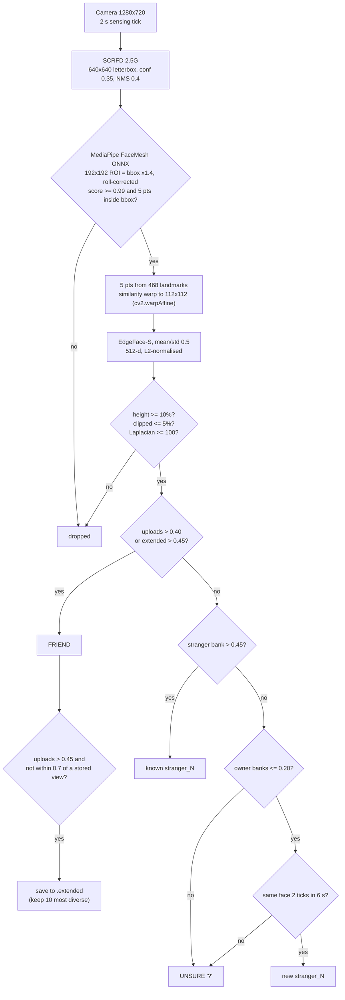
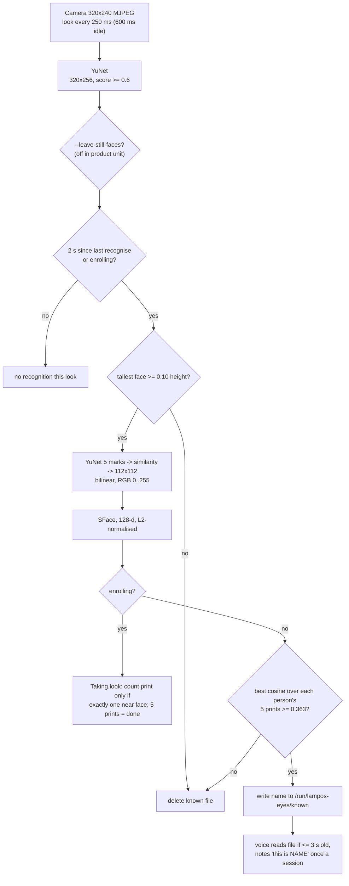

# Face recognition: V1 (HAL, `main`) vs V2 (lampOS Rust, `lamp-voice`)

Written 2026-11-18. Purpose: explain why V2 (SFace) recognises people worse
than V1, by comparing the two pipelines step by step.

Sources:

- **V1**: `origin/main` at `40fce18cd9`,
  `hal/drivers/sensing/perceptions/processors/faceid/` (`pipeline.py`,
  `scrfd.py`, `landmark.py`, `geometry.py`, `edgeface.py`, `recognizer.py`,
  `perception.py`, `model_store.py`), `hal/config.py`,
  `robots/lamp/rootfs/opt/hal/.env`, `skills/face-enroll/`.
- **Notion**: "[DRAFT] Autonomous Lamp AI Services" → "Face Recognition" and
  "v2 — SCRFD + MediaPipe + EdgeFace" (checked against `bb7c41875`,
  2026-10-19). Note that Notion's "v2" means the V1 HAL pipeline below. It is
  not lampOS V2.
- **V2**: `lamp-voice` at `ec8317fe2e`, `lampOS/crates/eyes/src/{main,who,faces,picture,sight}.rs`,
  `lampOS/crates/voice/src/known_faces.rs`, `lampOS/docs/eyes.md` ("Who is
  there"), `lampOS/deploy/product/lamp-eyes.service`.

Every number is from code or from a measurement those sources cite. Anything
marked **unmeasured** has no measurement behind it.

---

## 1. Summary

| | V1 (HAL, Python) | V2 (lampOS, Rust) |
|---|---|---|
| Detector | SCRFD 2.5G at 640×640 letterbox | YuNet 2023mar at 320×256 |
| Landmarks for alignment | MediaPipe FaceMesh (468 points on a 192×192 ROI), reduced to 5 points | YuNet's own 5 points |
| Embedder | EdgeFace-S γ0.5 (512-d per its paper; not read from the ONNX here) | OpenCV SFace 2021dec, 128-d |
| Camera frame used | **1280×720** (lamp `.env`) | **320×240** (`WORKING`, `main.rs:65`) |
| Face at the 10 % height floor | ~72 px tall | ~24 px tall |
| Quality gates | landmark score ≥ 0.99, height ≥ 10 %, ≤ 5 % clipped, Laplacian sharpness ≥ 100 | height ≥ 10 % only |
| Enrolment | photo(s) (Telegram, web, camera snapshot, MQTT), plus an auto-grown "extended" bank of up to 10 diverse live views per person | 5 prints from ~1.25 s of live looks, never updated |
| Match thresholds | uploads > 0.40, extended > 0.45, negative ≤ 0.20 (tuned on lamps, #299/#433) | ≥ 0.363 (OpenCV's LFW value, not tuned on a lamp) |
| Unknown people | stranger bank (50), minted after 2 ticks in 6 s, UNSURE band between | none: unknown = nobody |
| Decision cadence | every 2 s sensing tick | every 2 s |
| Identity persistence | friend stays "present" up to 3600 s unseen | name cleared on the **first** miss (file deleted) |
| Debug | per-detection capture (crops + scores) with `HAL_FACEID_DEBUG_LOG_ENABLED` | no likeness logged anywhere |
| Measured on a lamp | 38/38 usable frames recognised the owner on lamp-ac82 (#433); 990-frame replay with no false stranger (#299) | print latency only (152 ms on lamp-4ace); **recognition accuracy unmeasured** |

**Main conclusion.** The largest difference is the input, not the
embedder. V1 recognises from a 1280×720 frame with a dense-landmark
alignment and drops faces that are blurred, clipped or unreliable. It also
learns new poses as it goes. V2 recognises from a 320×240 frame, aligns from
YuNet's coarse 5 points, has no quality gate besides size, and enrols from
about one second of nearly identical frames. On top of that its threshold
was never tuned on lamp images and one bad frame clears the name. Changing
SFace to a stronger model alone would likely help less than fixing the
input and the decision logic (see section 5).

---

## 2. Flow side by side

### 2.1 V1 (HAL)

Then the presence state machine (`perception.py`): a friend is "new" after
3600 s unseen, which sends `presence.enter` and sets `current_user`. A
stranger alone also has to pass a gaze vote (2 of 3 ticks facing the lamp)
and a 300 s floor. A 10 s cooldown applies to every presence event.

### 2.2 V2 (lampOS)

---

## 3. Step-by-step comparison

### 3.1 Camera input

| | V1 | V2 |
|---|---|---|
| Capture size | `HAL_CAMERA_WIDTH/HEIGHT=1280×720` (`robots/lamp/rootfs/opt/hal/.env`) | 320×240 (`main.rs:65`). Up to 1280×960 only for `--full-look` stills, which recognition never uses |
| Face size at desk | ~86–194 px tall (0.12–0.27 × 720) | 29–65 px tall (`docs/eyes.md` measured 35–65 px on lamp-4ace) |
| Eye distance (rough) | ~35–80 px | ~10–25 px |
| Upscale to 112×112 | none or mild (often a downscale) | ×2–4 upscale |
| Compression | camera MJPEG at 720p | camera MJPEG at 320×240, 12–17 KiB a frame |

`docs/eyes.md` already flags this: *"Whether that is enough is to be measured
with people (the camera can give 640 by 480 if not)."* It was never measured.

### 3.2 Detection

| | V1 SCRFD 2.5G | V2 YuNet 2023mar |
|---|---|---|
| Input | 640×640 letterbox of the 720p frame | 320×256 (frame placed top-left, rest black) |
| Score threshold | 0.35, NMS 0.4 | 0.6 (`faces.rs:20`), NMS IoU 0.3 |
| Keypoints | 5, **used only to roll-correct the landmark ROI** | 5, **used directly for alignment** |
| False faces | filtered by the 0.99 landmark gate (#124, #299) | filtered only by score 0.6 (and `--leave-still-faces`, off in product) |

### 3.3 Alignment

Both use the same ArcFace reference points (`REFERENCE` in `who.rs:48`
equals `_REFERENCE_FACIAL_POINTS` in `geometry.py`) and a similarity
transform onto 112×112.

| | V1 | V2 |
|---|---|---|
| Where the 5 points come from | the means of dense FaceMesh landmarks (eyes = mean of 2 contour points each; nose tip 1; mouth corners 57/287) | YuNet's regressed 5 points on the 320-px picture |
| Point precision | subpixel on a 192×192 face ROI | about a pixel on a 25–65 px face, a large error relative to the face |
| Transform fit | least squares, with a reflection check (`_find_similarity`) | closed-form least squares, no reflection check (`who.rs:58`) |
| Warp | `cv2.warpAffine` bilinear on the full-res frame | own bilinear sampler on the 320-px frame; outside = black |
| Rejects bad alignment | yes: landmark score < 0.99 or a point outside bbox → dropped | no: any 5 marks with nonzero spread are accepted |

### 3.4 Embedder

| | V1 EdgeFace-S γ0.5 | V2 SFace 2021dec |
|---|---|---|
| File | `edgeface_s_gamma_05_opt.onnx`, 14,825,701 B | `face_recognition_sface_2021dec.onnx`, 38,696,353 B, SHA-256 pinned |
| Output | 512-d (per the EdgeFace paper, unchecked) | 128-d |
| Input normalisation | RGB, (x/255 − 0.5)/0.5 | RGB, raw 0–255 (matches OpenCV's `FaceRecognizerSF`) |
| Runtime | onnxruntime, 1 thread | tract, CPU |
| Latency on lamp | **unmeasured** (Notion) | 152 ms on lamp-4ace (236 ms first; 68 ms on the Mac) |
| Licence | per its upstream (not checked here) | Apache-2.0 (OpenCV zoo) |

The two models' published benchmark accuracies are not compared here,
because neither was measured on lamp images. On clean benchmark faces both
models are strong. The difference that matters on the lamp is how each one
copes with small, upscaled, badly aligned crops, and nobody has measured that.

### 3.5 Quality gates before matching

| Gate | V1 | V2 |
|---|---|---|
| Face size | bbox height ≥ 10 % of frame (≈72 px) | height ≥ 10 % (≈24 px) |
| Clipped at frame edge | ≤ 5 % of bbox outside (`HAL_FACE_MAX_TRUNCATION`) | none: outside pixels become black and still go into the print |
| Blur | Laplacian variance of the aligned crop ≥ 100 (`HAL_FACE_MIN_SHARPNESS`) | none |
| Landmark confidence | ≥ 0.99 (#299: 0.6 never fired) | none |
| Head turn | used only for the stranger greeting (gaze vote) | `turned` is computed in `sight.rs` but not used for recognition |

### 3.6 Enrolment

| | V1 | V2 |
|---|---|---|
| Paths | Telegram/web photo (Flow A), camera snapshot after a spoken warning (Flow B), familiar-stranger prompt (Flow C), MQTT `face.enroll` (#548). All go through `POST /face/enroll` | voice tool `remember_my_face(name)` → `{"remember":NAME}` on `who.sock` |
| What is stored | the JPEG photo(s) under `/root/local/users/<label>/`; embeddings rebuilt on every load | 5 prints (128 floats each) in `people.json`; no picture |
| Prints per person | one per uploaded photo, plus up to **10 extended live views** | exactly **5** |
| Diversity | extended views must be < 0.7 cosine to every stored view; keeps the 10 most diverse | none: the 5 prints come from consecutive looks every 250 ms, i.e. ~1.25 s of one pose and one light |
| Learns over time | yes: a live view the uploads match above 0.45 can join the extended bank (#148, #299, #433) | no: prints change only when the person asks to be remembered again |
| Model change | banks rebuilt from JPEGs, so switching embedder is free | prints are model-specific; a model change needs everyone to re-enrol |
| Limits | 50 strangers; no friend cap found | 20 people, 5 prints, names ≤ 40 chars |

### 3.7 Matching

| | V1 | V2 |
|---|---|---|
| Score | max cosine per bank (`_retrieve`) | max cosine over each person's 5 prints, best person wins |
| Friend bar | uploads **> 0.40**, extended **> 0.45** (separate bars: a shared 0.45 cost recall 92.0 % → 86.4 %, #299) | **≥ 0.363** for all |
| Where the bars come from | tuned on lamps: owner frontal 0.60–0.85, ¾ pose 0.29–0.34, strangers peak 0.23 (lamp-ac82, #433) | OpenCV's published SFace threshold, set on LFW-style images |
| Ambiguous band | 0.20 < score ≤ bar → UNSURE, never a stranger | none: below 0.363 = nobody |
| Unknown people | stranger bank; minted after 2 ticks in 6 s | not tracked (by design: "nobody is recognised until they ask", `docs/memory.md`) |
| Second-best margin | none | none |

### 3.8 Over time: from one frame to "who is here"

| | V1 | V2 |
|---|---|---|
| Recognise cadence | every 2 s tick | every 2 s (`RECOGNISE_EVERY`) |
| Voting across frames | for strangers (2 ticks to mint, gaze 2 of 3) | none |
| A friend stays "present" | until 3600 s unseen (`FACE_OWNER_FORGET_S`); presence persisted across HAL restarts in the same boot | while the `known` file is fresh (≤ 3 s, `FRESH`) |
| One bad frame | ignored for presence: the friend is still present | **deletes the `known` file at once** (`main.rs:836–848`); the voice then sees nobody |
| Session switch | n/a | a new session only after 30 s with no fresh file (`GONE_AFTER`), so short flicker does not open a session, but the name can be missing when the voice reads it |

### 3.9 Output and use

| | V1 | V2 |
|---|---|---|
| Events | `presence.enter` / `presence.leave` to os-server; `current_user`; `detected_faces` with `emotion_box` for FER | `known` file; `{"who":true}` reply with `likeness` |
| Agent sees | "Person detected — new: friend (a)…" plus snapshot paths | "The person at the lamp now is NAME: you know their face." once a session; hello by name |
| Per-person memory | shared `/root/local/users/<label>/` with speaker ID | memory scope per known person (#764) |

### 3.10 Privacy and storage

| | V1 | V2 |
|---|---|---|
| Who is stored | enrolled friends **and** strangers (embeddings, a 24 h snapshot, stats; 30-day retention) | only people who asked; nobody else |
| Pictures kept | enrolment photos, extended view JPEGs | none |
| Leaves the lamp | no (FER crops only with opt-in) | no |
| Model integrity | downloaded from GCS on first use; no hash check found | size + SHA-256 pinned before parsing |
| Failure mode | a failed weight download stops **all** sensing (Notion, open) | a wrong-size or wrong-hash SFace file makes `lamp-eyes` exit at start (`Recogniser::load(model)?`, `main.rs:341`), so face following stops too |

### 3.11 Debugging and evidence

| | V1 | V2 |
|---|---|---|
| Per-face log | scores, gates and drop reasons at INFO/DEBUG; optional capture of crop + aligned + frame (~43 ms/frame) | "remembered a face", "did not remember: why". **No likeness, size or score per recognition** |
| Accuracy evidence | #299 replay (990 frames), #433 lamp-ac82 38/38, #532 gaze test | none for recognition; enrolment verified only on lamp-52e6 (2026-10-15) |

---

## 4. Why V2 likely does worse, ranked

Ranked by how much each is likely to cost. All of them are inferred from the
code; none has been measured.

1. **About 3× fewer pixels on the face (320×240 vs 1280×720).** A 25–65 px
   face upscaled to 112 loses most of the detail the embedder relies on.
   V1's floor of 72 px is already larger than V2's typical desk face.
2. **Coarse alignment.** V2 aligns from YuNet's 5 points on the low-res
   frame. V1 aligns from FaceMesh points on a 192×192 ROI. Misalignment
   moves an embedding as much as a pose change does.
3. **No quality gate.** Blurred, clipped, side-on or low-confidence crops
   are printed and compared like good ones. V1 drops all of these. In #299
   these gates were the change that stopped false identities on a
   990-frame replay.
4. **Narrow enrolment.** 5 prints from about 1.25 s cover one pose and one
   light, and they never update. V1 needed the extended bank (#148) because
   side views of the owner were read as strangers.
5. **Untuned threshold.** 0.363 comes from LFW. V1 found that its own good
   bar sat in a different place on lamp images (0.30 → 0.40 for uploads,
   #433) after measuring score bands on a lamp. Nobody has measured V2's
   score bands.
6. **No smoothing across frames.** One miss deletes the name. V1 holds a
   friend present for an hour.
7. **Nothing to tune with.** No likeness or quality values are logged, so
   problems 1 to 6 cannot be told apart from the logs today.

---

## 5. What to take from V1 (proposal, not built)

In order of cost and expected gain. This is a proposal for discussion; it
needs the owner's go before any code changes.

| # | Change | V1 precedent | Cost in V2 |
|---|---|---|---|
| A | **Log per recognition**: face px height, eye distance, `turned`, YuNet score, best and second-best likeness | `debug_log.py`, #541 | small, `main.rs` only |
| B | **Recognise on a higher-resolution frame**: open at 640×480 (or 1280×720) and keep the 320-wide copy for detection/sight; map YuNet marks back and align from the full frame | 720p frame | medium: camera size, CPU per decode, `full_look.rs` already shrinks to 320 |
| C | **Quality gate** before printing: min eye distance in px, `|turned|` limit, YuNet score, sharpness of the aligned crop, reject if the face is clipped | #234, #299 | small |
| D | **Smooth over time**: keep the name until N misses or T seconds, and vote over 3 prints | `FACE_OWNER_FORGET_S`, stranger ticks | small |
| E | **Diverse enrolment**: take prints spaced in time/pose (e.g. ≥ 0.5 s apart, reject a print within 0.9 of one kept), longer window; optionally grow a small bank from confident live matches | extended bank, diversity 0.7 | medium; privacy review, since V2 keeps no data it was not asked for |
| F | **Tune the threshold** on lamp data from A, with a margin to the second-best person | #429/#433 bands | needs A plus a lamp session |
| G | **Better alignment**: a landmark model, or at least align from the higher-res frame (B) | FaceMesh 0.99 gate | larger: a new model on tract |
| H | **Embedder swap** (e.g. EdgeFace) only if A to F are not enough | #124 | large: new model, licence check, everyone re-enrols |

Suggested order: A first (measure on blue-lamp), then B + C + D together,
then F on the logged data, and E only if pose changes still fail.

---

## 6. Open questions

- What does SFace score on lamp images today, per pose and distance?
  Unmeasured. Item A answers it.
- How much CPU does decoding and detecting at 640×480 add on the A523, and
  does the 250 ms look cadence still hold? Unmeasured.
- Is growing a bank from live views acceptable under V2's privacy rule
  ("only what the person asked to keep")? This is a product decision.
- V1's EdgeFace licence and fit for lampOS have not been checked.
