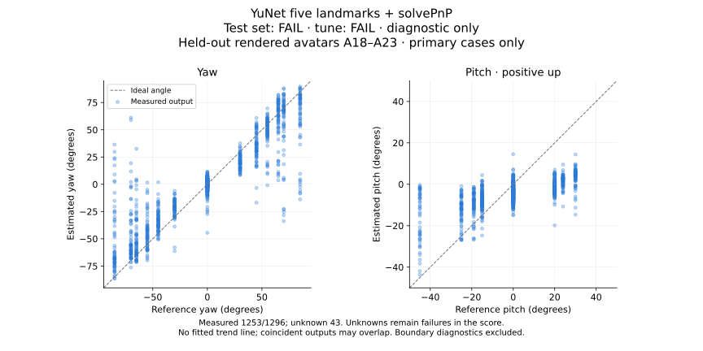
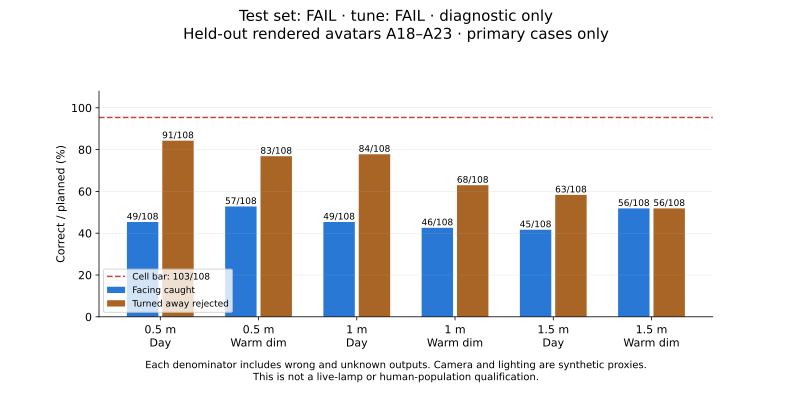

# EVAL: sensor 4, YuNet five landmarks + solvePnP

28 November 2026. Rubric `vision-public-synthetic-20261128-v1`.

**SET_BAR: FAIL. CONVERSION: NOT_RUN. STREAM: NOT_RUN.** The tuning stage failed, so the held-out test is diagnostic only. This offline candidate stays disabled. No own-model training, lamp installation, merge or deployment occurred.

The frozen cone `abs(yaw) <= 63`, `-3 <= pitch_up <= 10` caught **302/648 (46.60%)** facing cases and rejected **445/648 (68.67%)** turned-away cases on A18–A23. Both classes require at least **616/648**, and every distance/light cell requires **103/108** for each class. All six cells failed. Changing this cone or pipeline now requires a new version and an exposure note.

## Inputs and one-pass protocol

The input seal was [published before study inference](https://github.com/autonomous-ai/lampOS/issues/8847#issuecomment-7238694243). The ordered 5,472-row plan contains 2,736 unavailable training rows (A00–A11), 1,368 complete tune rows (A12–A17), and 1,368 complete test rows (A18–A23). Each evaluated split has 1,296 primary cases and 72 separate boundary diagnostics. Only the primary tune rows selected the cone. The tune result was 306/648 facing and 443/648 away, with 38 unknowns. The exact declared minimax selection rule maximizes the worst class/cell count before aggregate counts; it is not a maximum-total-accuracy fit.

Both test subsets were replayed once, then merged in manifest order and scored once against the frozen cone. All 2,736 PNG hashes are unique; there are no cross-split pixel aliases. The dataset occupies 228,583,951 bytes. Seven earlier A00 development previews are excluded. Earlier renderer failures, fixes and all original/derived data remain retained locally.

The renderer correction preceded model inference: float32 pose decomposition required two deterministic residual corrections to realize the prescribed head rotation. No geometry tolerance was relaxed and no prediction drove this correction. Independent materialization checks passed the original angular/position/matrix limits plus full-head projection and actual torso-rotation checks.

## Required quality counts

| Distance / light | Facing caught | Away rejected | Unknown |
| --- | ---: | ---: | ---: |
| 0.5 m / day | 49/108 | 91/108 | 2 |
| 0.5 m / warm dim | 57/108 | 83/108 | 9 |
| 1 m / day | 49/108 | 84/108 | 6 |
| 1 m / warm dim | 46/108 | 68/108 | 5 |
| 1.5 m / day | 45/108 | 63/108 | 8 |
| 1.5 m / warm dim | 56/108 | 56/108 | 13 |

The 1,296 primary test cases contain 1,253 measured outputs and 43 unknowns: 36 no-face, four ambiguous-face and three back-facing PnP solutions. Every unknown remains a failure in its original class denominator. There were zero input/processing exceptions, missing cases or excluded primary rows. No camera publication deadlines were measured.

Measured-only angular MAE is **12.53° yaw / 10.75° pitch**, with coverage **1,253/1,296**. The 72 boundary cases are separate: 17/48 facing caught, 16/24 away rejected, zero unknowns. They never entered fitting or primary rates.

| Procedural identity | Facing caught | Away rejected | Unknown |
| --- | ---: | ---: | ---: |
| A18 | 38/108 | 70/108 | 5 |
| A19 | 49/108 | 70/108 | 6 |
| A20 | 67/108 | 72/108 | 9 |
| A21 | 41/108 | 65/108 | 14 |
| A22 | 48/108 | 92/108 | 0 |
| A23 | 59/108 | 76/108 | 9 |

With shoulders at 0°, head-facing counts are 151/324 and 216/324, with 21 unknowns. At shoulder yaw 75°, they are 151/324 and 229/324, with 22 unknowns. These are head-only slices, not qualification of a joint head/shoulder estimator. Repeated poses and shared meshes are correlated observations, not independent human episodes.

The prescribed reference cone (60°, −20° to +25°), already included as a diagnostic before scoring, catches 620/648 facing but rejects only 260/648 away. It also fails. The plots show compressed pitch and large-angle yaw errors. Neither diagnostic replaces the selected cone or rescues qualification.

Independent descriptive counts explain the tradeoff: the selected rule raises the worst tuning class/cell from 10/108 under the reference cone to 48/108, still far below 103/108. Test yaw MAE increases from 6.24° at 0.5 m to 10.13° at 1 m and 21.43° at 1.5 m. At a true +30° pitch, median estimates are +4.77°, +5.10° and −0.53° at those distances. At 1.5 m, true yaw −85°/+85° has measured medians −30.05°/+53.58°. These are descriptive bins after scoring, not a new fit or a claim about real lamp behaviour.

## Public-photo diagnostic

All 2,790 Pointing'04 images (15 previously exposed people) were processed after synthetic scoring using the same frozen pipeline and actual Python/OpenCV/NumPy binary identities. No fitting, calibration, sign search, crop change or image removal occurred. There are 2,702 measured outputs and 88 unknowns (50 clipped, 22 back-facing, 13 no-face, three ambiguous).

Raw camera-Euler error against the existing nominal camera labels is **23.19° yaw / 33.90° pitch MAE**, coverage 2,702/2,790. Ray-cone agreement with the legacy inside/outside labels is **272/810** and **1,423/1,980**. This classification is a **camera-label proxy**, because an exact reference face-to-camera ray is unavailable. The 70°/zero-distortion camera assumption is unmeasured on these photographs. This reused source receives no fresh-subject or synthetic-set pass claim; its images are not redistributed or used for training/calibration.

## Runtime, models and timing limits

The primary route uses YuNet (232,589 bytes), five detected landmarks and the fixed MediaPipe canonical face (45,999 bytes), with EPNP followed by LM. It loads no face-mesh network or ONNX Runtime. The model, source, preprocessing, manifest, adapter, scorer and fitted cone are bound by SHA-256. Decoder minimum box size is four pixels; the unvalidated legacy 7.5% width heuristic was removed from this candidate before study inference, as declared in the pre-inference issue record.

The local runtime is Python 3.11.13, OpenCV 4.10.0 and NumPy 1.26.4 on x86_64. A same-process launcher verified exact runtime binaries before and after each replay. The core requests one OpenCV thread; this Mac build reports 16, so a single actual worker-thread claim is not made. OpenCL remained off.

Local raw timings retain the exact file-read/decode → detector → PnP result boundary, before JSON retention. Model loading is separate. They are not ARM timing, physical response latency, capture age or publication readiness. **No ARM warm/sustained, NPU conversion, CPU-fallback, thermal or voice-impact result is claimed here.** The board kit separately requests one cold call, ten saved warmups, 300 preselected fresh tune inputs and a 300-second paced replay; only the team lead operates the board. Live capture readiness remains null on file replay. The timing inputs are not the required training-derived NPU calibration tensors; training frames remain unavailable.

The [issue EVAL and operator handoff](https://github.com/autonomous-ai/lampOS/issues/8847#issuecomment-7238967370) contain the bounded ARM command. The private packet is 25,777,655 bytes, SHA-256 `fb8e74fb6ff5920c45975e2b463682b83a98631e94c67287d9361e103ff608d2`; timing seal `1d240720147cbd1f9b8570cf14d75519d7588a3c9ffac12ceb1eab66d97d624d`. Its independent 382-member byte/selection audit passed (`ad81365c45dfc1cc3d2938e49542245cbd9ad8e28390da996bcd8f6ce3cf06eb`). Packet validation is not ARM execution.

## Sources and reproducibility

The [English method and licence notes](METHOD.md) and [Vietnamese counterpart](METHOD_vi.md) describe the source package. The CC0 MPFB/MakeHuman output assets are separate from GPL renderer program code. All avatars share one base topology; twelve rendered evaluation identities do not establish population coverage. The rendered camera is a 320×240, 70° HFOV, zero-distortion proxy. Gold head angles are relative to the nose-tip-to-camera ray, with pitch positive up; raw camera Euler uses a different pitch convention. This is controlled synthetic evidence, not a real-lamp, gaze or human-interaction score.

Full per-class/cell/identity/shoulder and public diagnostic numbers are in [numeric-results.json](numeric-results.json). Runtime/config paths, images, model binaries and lamp data remain outside git.

| Provenance | SHA-256 |
| --- | --- |
| `recipe_sha256` | `f8b57acf50c5cac4f472326fbe5a73bf0df3b3aa348235ce453e42c0c8e4423a` |
| `manifest_sha256` | `df188c89ab663a1473f479d4be7716fd69ae6554fbed685a986d8e3f8609cd20` |
| `plan_sha256` | `321a78927cd87c585d1cc7a53bc7fcbc7f8dc22bfcdbe08a03fb5b3b4eb31e8f` |
| `scorer_sha256` | `fd767b0e84b02034ac58e0fa9256ddef80cbe7a3ce778f4a3c2d2e7c786f2d9f` |
| `tune_report_sha256` | `b9ea9078db5931f528112100a0d4d5a3af64d2e7bdd15ccfc7db69b13663841e` |
| `cone_lock_sha256` | `45def6cebf1c3de932c386268839a284c0fc0752d6ffda7412227b9c61c70098` |
| `test_report_sha256` | `929d17cbf31fbb88fd87a99d43d871a66ac98b9bb94bd0512c0be6eab6e1864e` |
| `pointing_report_sha256` | `17da40f3d94ccc2d8fa4fa746c0ef393b7801145017d84adf9a7df08f14af147` |
| `local_runtime_sha256` | `ce2826683affd054e25ca4bbbdff2721f20def55a777676b51c5479cf313fea0` |
| `runtime_launcher_sha256` | `02f1de0df244735684c16d97010ea988fad7e803b6ddbf63660babbc5e0d215f` |
| `materialized_input_seal_sha256` | `445a987c7e861ef2048071ef170e2beebdcf9fdc76171e6cb3e1f4f403f17abd` |
| `materialization_audit_sha256` | `ef2eae68db6794ad0c383c156e502158b0650d6fc7b4ef3d73c0ecee57295c1d` |
| `independent_result_audit_sha256` | `90fd452a3ba5a977c5802ea2a2f44f8d9f449d7b0744633d706d2e66c3324261` |
| `independent_pointing_audit_sha256` | `96ed53466d891e07b6745a703e48c5cd775b79e19da3a5b8d4b173a580b6710d` |

[Follow-up: unchanged PnP versus original 6DRepNet on renders and real photos](method-comparison.md). Both remain unqualified.
