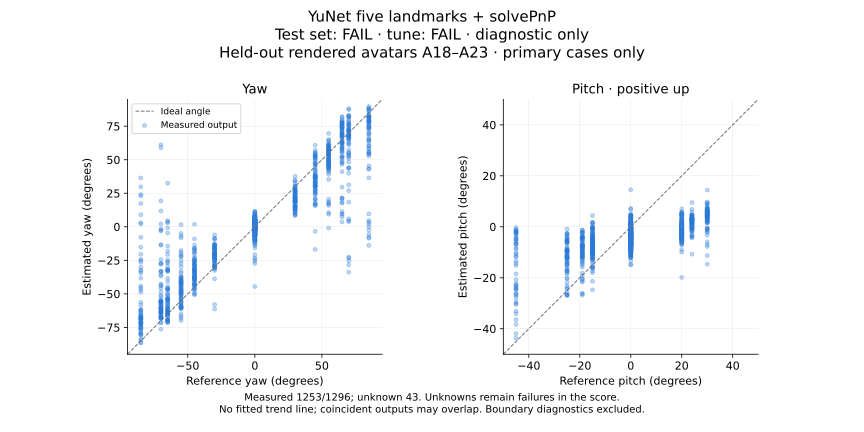
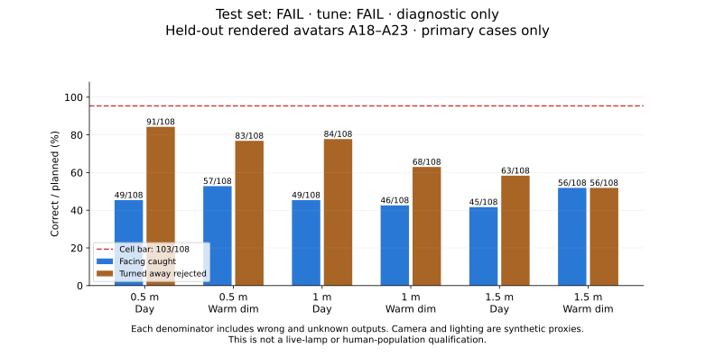

# EVAL: cảm biến 4, năm mốc YuNet + solvePnP

Ngày 28 tháng 11 năm 2026. Bộ tiêu chí `vision-public-synthetic-20261128-v1`.

**SET_BAR: FAIL. CONVERSION: NOT_RUN. STREAM: NOT_RUN.** Bước tinh chỉnh không đạt, nên kết quả trên tập kiểm tra chỉ có giá trị chẩn đoán. Ứng viên ngoại tuyến này tiếp tục bị tắt. Không huấn luyện mô hình riêng, cài lên đèn, merge hay triển khai.

Nón đã đóng băng `abs(yaw) <= 63`, `-3 <= pitch_up <= 10` nhận đúng **302/648 (46,60%)** trường hợp hướng mặt và loại đúng **445/648 (68,67%)** trường hợp quay đi trên A18–A23. Mỗi lớp cần tối thiểu **616/648**; mỗi ô khoảng cách/ánh sáng cần **103/108** cho từng lớp. Cả sáu ô đều không đạt. Mọi thay đổi nón hoặc pipeline từ thời điểm này phải có phiên bản mới và ghi rõ dữ liệu đã xem.

## Dữ liệu và quy trình một lượt

[Đã công bố dấu niêm phong dữ liệu trước suy luận](https://github.com/autonomous-ai/lampOS/issues/8847#issuecomment-7238694243). Kế hoạch có thứ tự gồm 5.472 hàng: 2.736 hàng huấn luyện không có ảnh (A00–A11), 1.368 hàng tinh chỉnh đầy đủ (A12–A17) và 1.368 hàng kiểm tra đầy đủ (A18–A23). Mỗi tập được dựng có 1.296 trường hợp chính và 72 trường hợp biên riêng. Chỉ các hàng tinh chỉnh chính chọn nón. Kết quả tinh chỉnh là 306/648 hướng mặt và 443/648 quay đi, với 38 đầu ra không xác định. Quy tắc minimax đã công bố ưu tiên số đúng thấp nhất trong từng lớp/ô trước số đúng tổng; không tối ưu riêng độ chính xác tổng.

Mỗi tập con kiểm tra chạy đúng một lượt, sau đó ghép theo thứ tự manifest và chấm một lần bằng nón đã đóng băng. Cả 2.736 mã băm PNG đều khác nhau; không trùng ảnh giữa các vai trò. Bộ dữ liệu chiếm 228.583.951 byte. Bảy ảnh xem trước A00 cũ bị loại khỏi nghiên cứu. Tất cả lần dựng thất bại, bản sửa, dữ liệu gốc và dẫn xuất đều được giữ cục bộ.

Bản sửa bộ dựng có trước suy luận: phép phân rã tư thế float32 cần hai lần hiệu chỉnh phần dư xác định để đạt góc đầu đã quy định. Không nới ngưỡng hình học và không dùng dự đoán để sửa. Kiểm tra độc lập xác nhận các giới hạn góc/vị trí/ma trận ban đầu, hình chiếu toàn đầu và góc thân thực tế.

## Số đúng theo tiêu chí bắt buộc

| Khoảng cách / ánh sáng | Nhận đúng hướng mặt | Loại đúng quay đi | Không xác định |
| --- | ---: | ---: | ---: |
| 0.5 m / day | 49/108 | 91/108 | 2 |
| 0.5 m / warm dim | 57/108 | 83/108 | 9 |
| 1 m / day | 49/108 | 84/108 | 6 |
| 1 m / warm dim | 46/108 | 68/108 | 5 |
| 1.5 m / day | 45/108 | 63/108 | 8 |
| 1.5 m / warm dim | 56/108 | 56/108 | 13 |

1.296 trường hợp kiểm tra chính gồm 1.253 đầu ra đo được và 43 không xác định: 36 không thấy mặt, bốn nhiều mặt gây mơ hồ và ba nghiệm PnP quay ngược. Tất cả đầu ra không xác định vẫn là thất bại trong mẫu số lớp gốc. Không có ngoại lệ đầu vào/xử lý, trường hợp thiếu hay hàng chính bị loại. Chưa đo hạn chót công bố kết quả từ camera.

MAE chỉ trên đầu ra đo được là **12,53° yaw / 10,75° pitch**, độ bao phủ **1.253/1.296**. 72 trường hợp biên được báo riêng: 17/48 hướng mặt, 16/24 quay đi, không có đầu ra không xác định. Chúng không tham gia chọn nón hoặc tỷ lệ chính.

| Danh tính hình học thủ tục | Nhận đúng hướng mặt | Loại đúng quay đi | Không xác định |
| --- | ---: | ---: | ---: |
| A18 | 38/108 | 70/108 | 5 |
| A19 | 49/108 | 70/108 | 6 |
| A20 | 67/108 | 72/108 | 9 |
| A21 | 41/108 | 65/108 | 14 |
| A22 | 48/108 | 92/108 | 0 |
| A23 | 59/108 | 76/108 | 9 |

Khi vai ở 0°, số đúng theo hướng đầu là 151/324 và 216/324, có 21 không xác định. Khi vai xoay 75°, các số là 151/324 và 229/324, có 22 không xác định. Đây chỉ là các lát cắt theo hướng đầu, không đánh giá bộ ước lượng kết hợp đầu/vai. Các tư thế lặp lại và lưới dùng chung có tương quan, không phải các tương tác người độc lập.

Nón tham chiếu (60°, −20° đến +25°), đã được quy định là chẩn đoán trước khi chấm, nhận 620/648 hướng mặt nhưng chỉ loại 260/648 quay đi. Nón này cũng không đạt. Biểu đồ cho thấy pitch bị nén và sai số yaw ở góc lớn. Các chẩn đoán không thay nón đã chọn và không làm kết quả trở thành đạt.

Kiểm đếm mô tả độc lập giải thích sự đánh đổi: quy tắc đã chọn nâng số đúng thấp nhất theo lớp/ô của tập tune từ 10/108 với nón tham chiếu lên 48/108, vẫn thấp hơn nhiều so với 103/108. MAE yaw trên tập test tăng từ 6,24° ở 0,5 m lên 10,13° ở 1 m và 21,43° ở 1,5 m. Với pitch thật +30°, trung vị ước lượng lần lượt là +4,77°, +5,10° và −0,53°. Ở 1,5 m, yaw thật −85°/+85° có trung vị đo được −30,05°/+53,58°. Đây là các nhóm mô tả sau chấm, không phải lần khớp mới hay kết luận về hành vi đèn thật.

## Chẩn đoán trên ảnh công khai

Toàn bộ 2.790 ảnh Pointing'04 (15 người đã được sử dụng trước đó) chạy sau chấm tập tổng hợp, với cùng pipeline và cùng mã băm nhị phân Python/OpenCV/NumPy. Không chọn lại ngưỡng, hiệu chuẩn, tìm dấu góc, đổi crop hay loại ảnh. Có 2.702 đầu ra đo được và 88 không xác định (50 mặt bị cắt, 22 quay ngược, 13 không thấy mặt, ba mơ hồ).

MAE Euler camera gốc so với nhãn camera danh nghĩa hiện có là **23,19° yaw / 33,90° pitch**, độ bao phủ 2.702/2.790. Mức phù hợp của nón theo tia với nhãn trong/ngoài cũ là **272/810** và **1.423/1.980**. Phân loại này chỉ dùng **nhãn camera đại diện**, vì không có tia mặt-đến-camera tham chiếu chính xác. Giả định camera 70°/không méo chưa được đo trên các ảnh này. Không tuyên bố đạt trên người chưa từng xem hoặc trên tập tổng hợp; không phân phối lại ảnh hay dùng chúng cho huấn luyện/hiệu chuẩn.

## Runtime, mô hình và giới hạn thời gian

Luồng chính dùng YuNet (232.589 byte), năm mốc phát hiện và mặt chuẩn MediaPipe cố định (45.999 byte), giải EPNP rồi LM. Không tải mạng face-mesh hoặc ONNX Runtime. Mô hình, nguồn, tiền xử lý, manifest, adapter, bộ chấm và nón đều được ràng buộc bằng SHA-256. Bộ giải mã yêu cầu khung tối thiểu bốn pixel; quy tắc chiều rộng 7,5% cũ chưa được kiểm chứng đã được bỏ cho ứng viên này trước suy luận, đúng như ghi nhận trước nghiên cứu.

Runtime cục bộ: Python 3.11.13, OpenCV 4.10.0 và NumPy 1.26.4 trên x86_64. Bộ chạy cùng tiến trình xác minh nhị phân trước/sau mỗi lượt. Mã nguồn yêu cầu một luồng OpenCV; bản Mac này báo 16, nên không khẳng định thực tế chỉ có một worker. OpenCL tắt.

Thời gian thô cục bộ giữ ranh giới đọc/giải mã tệp → detector → kết quả PnP, trước khi ghi JSON; tải mô hình báo riêng. Đây không phải thời gian ARM, phản hồi vật lý, tuổi ảnh hay độ sẵn sàng công bố. **Chưa có kết quả ARM warm/duy trì, chuyển đổi NPU, CPU fallback, nhiệt hoặc ảnh hưởng đến voice.** Bộ kit cho bo mạch yêu cầu một lượt cold, mười warmup được lưu, 300 đầu vào tune mới đã chọn trước và replay có nhịp trong 300 giây; chỉ trưởng nhóm vận hành bo. Độ sẵn sàng camera trực tiếp là null khi replay tệp. Các ảnh đo tốc độ không phải tensor hiệu chuẩn NPU từ tập train; ảnh train vẫn chưa có.

Lệnh ARM có giới hạn nằm trong [EVAL và bàn giao trên issue](https://github.com/autonomous-ai/lampOS/issues/8847#issuecomment-7238967370). Gói riêng có 25.777.655 byte, SHA-256 `fb8e74fb6ff5920c45975e2b463682b83a98631e94c67287d9361e103ff608d2`; dấu niêm phong thời gian `1d240720147cbd1f9b8570cf14d75519d7588a3c9ffac12ceb1eab66d97d624d`. Kiểm tra độc lập byte/lựa chọn của 382 thành viên đã đạt (`ad81365c45dfc1cc3d2938e49542245cbd9ad8e28390da996bcd8f6ce3cf06eb`). Xác minh gói không phải là đã chạy ARM.

## Nguồn và khả năng tái lập

[Xem phương pháp và giấy phép tiếng Anh](METHOD.md) và [tiếng Việt](METHOD_vi.md). Tài sản đầu ra MPFB/MakeHuman CC0 tách biệt với mã chương trình dựng GPL. Các avatar dùng chung một topology; mười hai danh tính được dựng để đánh giá không chứng minh độ bao phủ dân số. Camera tổng hợp là đại diện 320×240, HFOV 70°, không méo. Góc đầu chuẩn tính theo tia chóp mũi đến camera, pitch dương hướng lên; Euler camera gốc dùng quy ước pitch khác. Đây là bằng chứng tổng hợp có kiểm soát, không phải điểm cho đèn thật, ánh nhìn hay tương tác người.

[numeric-results.json](numeric-results.json) chứa đầy đủ số theo lớp/ô/danh tính/vai và chẩn đoán công khai. Đường dẫn runtime/config riêng, ảnh, mô hình nhị phân và dữ liệu đèn không vào git.

| Nguồn gốc | SHA-256 |
| --- | --- |
| `recipe_sha256` | `f8b57acf50c5cac4f472326fbe5a73bf0df3b3aa348235ce453e42c0c8e4423a` |
| `manifest_sha256` | `df188c89ab663a1473f479d4be7716fd69ae6554fbed685a986d8e3f8609cd20` |
| `plan_sha256` | `321a78927cd87c585d1cc7a53bc7fcbc7f8dc22bfcdbe08a03fb5b3b4eb31e8f` |
| `scorer_sha256` | `fd767b0e84b02034ac58e0fa9256ddef80cbe7a3ce778f4a3c2d2e7c786f2d9f` |
| `tune_report_sha256` | `b9ea9078db5931f528112100a0d4d5a3af64d2e7bdd15ccfc7db69b13663841e` |
| `cone_lock_sha256` | `45def6cebf1c3de932c386268839a284c0fc0752d6ffda7412227b9c61c70098` |
| `test_report_sha256` | `929d17cbf31fbb88fd87a99d43d871a66ac98b9bb94bd0512c0be6eab6e1864e` |
| `pointing_report_sha256` | `17da40f3d94ccc2d8fa4fa746c0ef393b7801145017d84adf9a7df08f14af147` |
| `local_runtime_sha256` | `ce2826683affd054e25ca4bbbdff2721f20def55a777676b51c5479cf313fea0` |
| `runtime_launcher_sha256` | `02f1de0df244735684c16d97010ea988fad7e803b6ddbf63660babbc5e0d215f` |
| `materialized_input_seal_sha256` | `445a987c7e861ef2048071ef170e2beebdcf9fdc76171e6cb3e1f4f403f17abd` |
| `materialization_audit_sha256` | `ef2eae68db6794ad0c383c156e502158b0650d6fc7b4ef3d73c0ecee57295c1d` |
| `independent_result_audit_sha256` | `90fd452a3ba5a977c5802ea2a2f44f8d9f449d7b0744633d706d2e66c3324261` |
| `independent_pointing_audit_sha256` | `96ed53466d891e07b6745a703e48c5cd775b79e19da3a5b8d4b173a580b6710d` |
