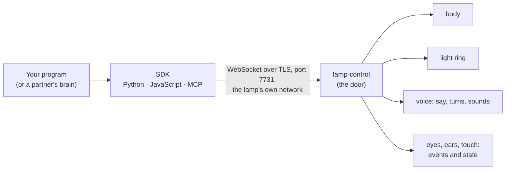

# The lamp SDK: a guide for day 0

This guide is for a team deciding whether to build on the lamp. It says what
the lamp is, how a program drives it, what each call does, and what works
today, comes next, or is still planned. It links to the reference documents
rather than copying them:

- the protocol: [docs/control.md](../docs/control.md) and its messages,
  [docs/control.schema.json](../docs/control.schema.json);
- the SDKs: [Python](python/README.md), [JavaScript](js/README.md),
  [MCP](mcp/README.md), and the [coverage map](README.md);
- the lamp's own message bus: [docs/bus.md](../docs/bus.md).

**Status words** used throughout:

- **works today:** on customer lamps, shown on a test lamp running a customer
  build (the stable build, the newest one as lampos-stable serves it; among those so far 10824, 11048, 11091, 11308, 11372, 11450 since 10 Nov 2026, and on 12 Nov 12226 since 11:06, 12337 since 17:09, 12391 since 19:16 and 12431 since 20:48, from the first builder's posts on #6059), with the date;
- **in today's build, lamp run pending:** in the customer build's code (the newest stable build, as lampos-stable serves it),
  not yet shown on a lamp;
- **next build:** built and merged (or in review, with its pull request); comes
  with the next update;
- **in development:** being built: what exists is said;
- **planned:** designed or agreed, not started.

Each status row says the date it was last verified.

## The landscape

The lamp is a desk lamp with a body: a base that turns (yaw), a head that
nods (pitch) and tilts (roll), and an arm with a shoulder and an elbow. It has
a ring of 32 lights, a speaker, microphones, a camera, a touch-sensitive head
and a button. It runs its own life: it hears its name, talks with the person,
looks around, rests.

A program drives the lamp through one door on the lamp, `lamp-control`. The
SDKs speak its protocol for you.



- **What runs where:** the SDK runs on a computer on the lamp's local network
  (Python 3.10+, Node 20.11+, or an MCP client). The door runs on the lamp.
  Nothing goes through the cloud, and the lamp opens no port to the internet.
- **The owner decides:** the door is closed until the lamp's owner turns
  developer access on in the app and pairs a computer, ticking what it may do
  (the grants). The person at the lamp always comes first: talking to it, a
  hand on it, the privacy switch or "stop" take the lamp back from any program.
- **The partner edition (planned):** a partner writes one app, a "brain". It
  is installed on a special edition of the lamp, runs on the lamp itself,
  drives it through the same SDK over the lamp's own door, and reaches the
  partner's cloud by itself. The app links the lamp to the owner's account
  with the partner, with a consent screen in the grants' words. Until then,
  the same program runs on a computer on the lamp's network (section 3), with
  no change to its code.
- **The SDK's own repository (planned, no date):** today you clone this
  repository and install from its `lampOS/sdk/` folders. The SDKs (Python,
  JavaScript, MCP) are planned to move to a repository of their own, with
  their own releases, and the protocol's schema versioned there. Only where
  you install from changes: the packages keep their names, `lampos` and
  `lamp-mcp`, and so does every import and call in this guide.

## How the app looks

The owner's steps in our app, today:

1. **Set up the lamp** as for any lamp: Wi-Fi and the account.
2. **Turn developer access on** in the lamp's settings. Until then nothing
   listens on the door. Turning it off closes every computer's connection.
3. **Add a developer computer** and tick what it may do. The grants, in the
   words the app shows:
   - `body`: can move the lamp's body;
   - `light`: can change the light;
   - `speak`: can speak and play sounds;
   - `look`: can tell when someone is there, never who;
   - `hear`: can hear its own phrases, never the words around them;
   - `sound`: can hear kinds of sound, never words;
   - `skills`: can put skills on the lamp that run on their own;
   - `air`: can read the air sensor: particles, carbon dioxide and humidity, which
     can show when someone is in the room;
   - `device`: can read the lamp's processor, memory, disk and temperature;

   `body`, `light`, `speak` and `look` are ticked by default. **The app offers no
   `camera`, no `microphone` and no `notes` tick** (App Only, 11 Nov 2026: nine
   grants in the app's `LampControlGrant`, "the camera and the microphone are never
   offered from the app"; the current TestFlight, 2.5.2, is the same). See "Granting
   camera, microphone and notes today" below.
4. **Check it is the right lamp.** The lamp says the first 8 characters of its
   security pin aloud, and the app shows the same 8 for the owner to confirm
   they match. Only then does the app show a one-time code (8 digits, 5
   minutes) and the lamp's full pin (64 hex characters). If the lamp couldn't
   say its pin, the app cancels the code; ask for a new one.
5. **Pair** the computer with that code and pin (section 3). The lamp gives a
   small nod. The owner can take the body back, or remove the computer, from
   the app at any time; removing it closes its connections at once.

### Granting camera, microphone and notes today

A pairing starts with the grants its code was made with. The owner's side can change them
later with no new code: `lamp-control grants CLIENT --grants LIST` at the lamp (as root, on
the admin socket), or the app's `control.set_grants`, which the owner's tap makes. The list
replaces the grants whole, so name every one the computer keeps. A list that names a linked service's grant is
refused: those are a skill run's alone. A re-pair replaces them too. When the
grants change the lamp closes the computer's connections, saying "grants changed by the
owner", and the program reads the new ones at its next `hello`. For each grant:

| grant | how a developer gets it | where it stops |
|---|---|---|
| `body`, `light`, `speak`, `look`, `hear`, `sound`, `skills`, `air`, `device` | the owner ticks it in the app (step 3) | nowhere |
| `camera` | a pairing code made on the lamp: its keeper, as root, runs `lamp-control code --grants body,camera` (the admin socket, `/run/lampos-control/admin.sock`, 0600; developer access on); then `lamp pair` as in step 5. For a computer already paired, `lamp-control grants CLIENT --grants body,camera` (the whole list) | whether the app offers it is the first builder's decision (below); the stream is local network only, with the ring's red dot, never while the lamp is private |
| `microphone` | the same, with `microphone` in the list | the grant alone is not enough: the stream is off unless `lamp-control` runs `--microphone on` and the ears share their sound (`LAMP_BUS_AUDIO=on`), which the customer build does not: a stream ends "the microphone stream is off on this lamp (LAMP_CONTROL_MICROPHONE)" |
| `speaker` | the same, with `speaker` in the list | the grant alone is not enough: the stream is off unless `lamp-control` runs `--speaker on` (`LAMP_CONTROL_SPEAKER`), which no unit sets; the pairing screen says it "can play any sound through the lamp's speaker, not only the lamp's own voice, so it can sound like a person; never while the lamp is private"; the app does not offer it |
| `notes` | the same (a code made on the lamp) | not on the app's screen either, per App Only's list of nine |

Asking for one without it is refused `no_grant`: "not granted: camera (only the owner can add it:
with a new pairing code that names it, or by changing the grants of this computer)". Hand-editing a
pairing's file is not a way: it skips the owner's consent. Whether the app will offer
`camera` and `microphone` is the first builder's decision (it widens what a developer computer can
take from the room); the proposal, with the owner's switch for the microphone, is on #6059.


**Planned for a partner edition** (the app's four screens, words only):

1. at the end of setup, a "Connect the partner" page, from the edition's record;
2. the partner's own sign-in;
3. our consent page: what the partner's brain may do, in the grants' words, one tap;
4. on the lamp's page, one row for the brain: on or off, its state, Disconnect,
   and "take the lamp back now".

## Getting started

**Install from a clone.** The SDKs aren't on PyPI or npm yet. They live on the
repository's `lamp-voice` branch (the default branch, `main`, has none). When
the SDK moves to its own repository (planned), only these install lines change;
`import lampos`, `import { Lamp } from 'lampos'` and `lamp-mcp` stay as they are.

```sh
git clone --branch lamp-voice https://github.com/autonomous-ai/lampOS.git && cd lampOS
python3 -m venv ~/lampos-venv && . ~/lampos-venv/bin/activate
pip install ./lampOS/sdk/python                     # add ./lampOS/sdk/mcp for lamp-mcp
```

```sh
# JavaScript, in your own project: install a copy, not a link, so Node finds its ws
npm i --install-links /path/to/lampOS/lampOS/sdk/js
```

**Start with no lamp.** `lamp fake` is a lamp on your own computer. It pairs
with it at once, answers each call as a lamp does (refusals in the lamp's own
words), and plays a small day on its own: someone arrives, a phrase is heard,
they leave.

```sh
LAMPOS_HOME=/tmp/lampos-try lamp fake                 # terminal 1
LAMPOS_HOME=/tmp/lampos-try python examples/greet.py  # terminal 2, from lampOS/sdk/python
```

**Pair with a real lamp**, on its network, with the code and pin from the
app. The lamp doesn't announce itself on the network yet, so give its address:

```sh
lamp pair 12345678 --pin 3f9a… --host lamp-xxxx.local   # or its IP address
lamp hello                                               # connects, shows the grants
```

The SDK checks the lamp's certificate against the pin after the TLS and
WebSocket handshakes and before any protocol frame, so a pairing never goes
to another host. The pairing is kept in `~/.config/lampos/`; later
connections need no code.

**Say hello:**

```python
import asyncio
from lampos import Lamp

async def main():
    async with await Lamp.connect() as lamp:
        said = asyncio.Event()
        await lamp.on("done", lambda event: said.set())   # the line has been spoken
        await lamp.say("Hello from my computer.")
        await asyncio.wait_for(said.wait(), 30)          # closing earlier stops it

asyncio.run(main())
```

```js
import { Lamp } from 'lampos';
const lamp = await Lamp.connect();
const said = new Promise((resolve) => lamp.on('done', resolve));
await lamp.say('Hello from my computer.');
await said;
await lamp.close();
```

For an agent: `lamp-mcp` serves the same calls as MCP tools, only those the
pairing's grants allow ([mcp/README.md](mcp/README.md)).

## Every function, in detail

One table per part of the lamp. Each row is one call: its Python name (`lamp.` is a
connected `Lamp`), its JavaScript name, the MCP tool an agent calls (`—` when lamp-mcp has
none), the grant the owner must tick, the limits the lamp holds it to, what comes back, the
refusals in the lamp's own words, and its status.

**How to read the columns**

- **Refusals:** a refused call raises a typed error in Python (`RefusedError`, `BusyError`,
  `NoGrantError`, ...) and rejects in JavaScript (`err.code`, `err.why`). In MCP the tool
  fails with `code: why`. The words shown are copied from the lamp's code. `…` marks a part
  the lamp fills in, such as a number or a name.
- **Status** has five words. *Works today* means shown on a test lamp on a customer
  build (the stable build, the newest one as lampos-stable serves it; among those so far 10824, 11048, 11091, 11308, 11372, 11450 since 10 Nov 2026, and on 12 Nov 12226 since 11:06, 12337 since 17:09, 12391 since 19:16 and 12431 since 20:48, from the first builder's posts on #6059), with the date. *In today's build, lamp run pending* means the code is
  on customer lamps (the newest stable build, as lampos-stable serves it) but no run shows it yet. *Next build* means it is on the
  development branch, not in the newest stable build. *In development* means the lamp refuses it today and says
  so. *Planned* means it is named in the protocol but nothing serves it yet.
- **Every op but `pair` and `hello`** needs `hello` first on the connection (`no_hello`,
  "say hello first"). A missing grant is always `no_grant`, "not granted: …" with the grant's
  name; for `camera` and `microphone` it adds "(only the owner can add it: with a new pairing code that names it, or by changing the grants of this computer)",
  since the owner can add them with a new pairing code or by changing the computer's grants (the fakes say the same).
- **The rates are off by default** on customer lamps (`limits.rates` is `"off"`). The rates in
  the Limits column hold only where the lamp's `--rates default` is set, except the phrase
  cap and "refused actions: 20 a second", which always hold.

### Connect, pair, limits

| Python | JavaScript | MCP tool | What it does | Grant | Limits | Answer | Refusals | Status |
|---|---|---|---|---|---|---|---|---|
| `Lamp.pair(code, host, pin=...)`; CLI `lamp pair CODE --pin PIN --host HOST` | `Lamp.pair(code, host, { pin })` | — (pair with the CLI first; `lamp-mcp` uses the pairing kept) | Op `pair`: checks the lamp's certificate against the app's pin before any frame, then sends this computer's new key with a proof of the code | the grants the owner ticks in the app | code: 8 digits, 5 min, one at a time; `name` 1–64 chars; one pairing try a second; at most 16 computers a lamp | `{client, grants}`; Python returns a `Pairing` and keeps it | `unpaired` "no pairing code is out: ask for one in the app"; `unpaired` "the proof does not hold for the code out"; `unpaired` "this lamp keeps as many computers as it can"; `rate` "one pairing try a second"; SDK: "the code is the 8 digits the app shows" | works today (9 Nov 2026). No mDNS on customer lamps: pass `--host` (the lamp's `.local` name or IP) |
| `await Lamp.connect(lamp=None, host=None)` | `await Lamp.connect(lamp, { host })` | started by running `lamp-mcp` (`--lamp`, `--client`) | Opens the connection, reads the `welcome`, sends op `hello` signed with this computer's key | — | one `hello` a connection; closed after 2 min with nothing sent (the SDKs ping every 20 s); at most 4 connections from one address, 32 in all | a `Lamp` with `info` (id, name, `v`), `grants`, `limits` | `unpaired` "not paired, or the signature does not hold" (the connection closes); `bad_request` "hello once a connection"; `unpaired` "this computer's pairing was revoked"; SDK: "no pairing here for that lamp: run `lamp pair` first" | works today (9 Nov 2026) |
| `lamp.limits`, `lamp.ring_pixels` | `lamp.limits`, `lamp.ringPixels` | — | What the lamp holds this computer to, read from `hello` | — | — | `rates` (`"off"` by default) or each class's `{most, within_ms}`; `hold_max_ms` 30000; `lease_max_ms` 600000; `say_max_bytes` 900; `quiet_hours` (`"off"` by default); `sounds`; `ring.pixels` (32) | — | works today (9 Nov 2026) |
| `lamp.language` | `lamp.language` | — | The owner's language, read from `hello`'s `lamp` (also in the `welcome`), so a program's own lines can follow it: `en`, `vi`, `ja`, `zh` or `ko`; `en` from a lamp that says none (one from before this) | — | — | `"en"`, `"vi"`, `"ja"`, `"zh"` or `"ko"` | works today (11 Nov 2026, lamp-75c9 on 11913, tag `lampos-lamp-voice-11913` 86ae3fdae6; #6261): read as `en`, the owner's; again on 12226 (12 Nov 2026, 16:25) |
| `lamp.lease("body", for_ms=30_000, why=None)`, used as `async with`; renewed for you at half its time; `await lease.release()` | `lamp.lease('body').take()`, `lease.renew()`, `lease.release()`, or `lamp.withLease(['body'], fn, { forMs, why })` | taken for you around `lamp_look`, `lamp_move`, `lamp_play`, `lamp_joints`, `lamp_follow_hand`; resource `lamp://lease` | Ops `lease.take`, `lease.renew`, `lease.release`: holds a part (`body`, `light` or `voice`) so the lamp's own life stands back | `body`, `light` or `speak`, one for each part | `for_ms` 1–600,000 a take or renewal, renewed with no ceiling; `why` ≤ 200 chars; one holder a part | `{lease: "l_…", for_ms}`; `lease` events say `held`, `suspended`, `lost` (hear one end with `lamp.on('lease', h)`, `state` `lost`: there is no `lease.ended`) | `busy` "another computer holds the body" (or the light, the voice); `busy` "suspended while someone talks to the lamp"; `busy` "you already hold the body: use the lease you have" (a second `lease.take` of the same pairing, shown 11 Nov 2026, lamp-75c9 on stable 11716); `no_lease` "no such lease of this computer's"; `lease_lost` with how it ended (`hand`, `expired`, ...); `bad_request` "for_ms: from 1 to 600000" | works today (9 Nov 2026) |
| `lamp.request(op, **fields)` | `lamp.request(op, fields)` | — | Sends any op as written in `control.schema.json` and awaits its reply | the op's | the op's | the reply | the op's | the op's |
| `await lamp.close()` | `await lamp.close()` | — | Releases this computer's leases and closes | — | — | — | — | works today (9 Nov 2026) |

**On the lamp itself, with no pairing.** A program that runs on the lamp as the one user the owner turned on (the local agent, [docs/control.md](../docs/control.md), "The local agent") needs no `lamp pair`: with no pairing found, and no `host` asked for, `Lamp.connect()` (Python and JavaScript, and so the CLI and `lamp-mcp`) uses the socket `/run/lampos-agent/agent.sock` (`LAMPOS_AGENT_SOCKET` names another), says `hello` with no key, and holds exactly the grants the owner left that user: body, light, speak, look and skills at first, never the camera, the microphone, what the lamp says, its logs or its speaker unless the owner gives them in the app. A pairing, when there is one, is used as before; a program of any other user is refused by the lamp before it says a word. Inside a skill's run (`LAMP_CONTROL_TOKEN` set and not empty), with no pairing and no `host`, `Lamp.connect()` is `Lamp.local(token)` (Python and JavaScript): the run's own grants, not the agent's, tried before the agent socket; a pairing still wins, an empty token is not set, and the token is never in an error or a log line.

### State (`get`)

Op `get` takes `state`, a list of names. Each name comes back under `state`.

| Python | JavaScript | MCP tool | What it does | Grant | Limits | Answer | Refusals | Status |
|---|---|---|---|---|---|---|---|---|
| `lamp.get("presence", "light", "mood", "lamp", ...)` | `lamp.get('presence', 'light', ...)` | `lamp_state(which)`; resources `lamp://state/<name>` | The states asked for: `presence` (how many in view, how near, never who), `light`, `mood`, `lamp` (talking, paused, private, asleep, the lease holder) | `presence` needs `look`; `light`, `mood`, `lamp` need none | `state`: at least one | `{presence: …, light: …, mood: …, lamp: …}` | `bad_request` "state: at least one"; `no_grant` "not granted: look" | works today (9 Nov 2026) |
| `lamp.body_info()` | `lamp.bodyInfo()` | `lamp_state(["body"])` | State `body`: each joint (`yaw`, `pitch`, `roll`, `shoulder`, `elbow`) with `deg` from its home, `min_deg`, `max_deg` and its counts; the speed, load and heat limits | `body` | `{known: false, why}` when the body said nothing in the last 15 s. The head's bounds are a folded lamp's: don't clamp a target to them | `{known: true, joints: {…}, …}` | `no_grant` "not granted: body" | works today (9 Nov 2026) |
| `lamp.air()` | `lamp.air()` | `lamp_state(["air"])` | State `air`: `pm1_0`, `pm2_5`, `pm4_0`, `pm10`, `co2_ppm`, `humidity`, `temperature` (inside the base, not the room's), `feel` | `air` | `{known: false}` with no reading in the last 15 s | `{known: true, …}` | `no_grant` "not granted: air" | in today's build, lamp run pending: lamp-75c9 cannot show it (10 Nov 2026, on 11450's lamp-control `get` of `air` answered `known: false` and no `air.changed` came: its base has no air reading); it needs a lamp with the air sensor |
| `lamp.device()` | `lamp.device()` | `lamp_state(["device"])` | State `device`: the lamp's own computer: `cpu_load`, `memory_used`, `disk_free`, `uptime_s`, `temperature_c` | `device` | `{known: false}` with no reading in the last 15 s | `{known: true, …}` | `no_grant` "not granted: device" | works today (10 Nov 2026, lamp-75c9 with the lamp-control of build 11450): `get` of `device` answered `known: true` with `cpu_load`, `memory_used`, `disk_free`, `uptime_s` and `temperature_c` (eight zones, 75 to 82 °C) |
| `lamp.get("volume")` | `lamp.get('volume')` | `lamp_state(["volume"])` | State `volume`: the speaker's `{level, muted}` | `speak` | `null` until the lamp has said it once | `{level, muted}` | `no_grant` "not granted: speak" | works today (9 Nov 2026): `{"level": 20, "muted": false}` read on a test lamp on the customer build |

### Events

A program subscribes by name and gets `ev` messages. The full list of events, their fields
and grants is in "Events" at the end of this section.

| Python | JavaScript | MCP tool | What it does | Grant | Limits | Answer | Refusals | Status |
|---|---|---|---|---|---|---|---|---|
| `lamp.on(event, handler, phrases=None)`; `lamp.subscribe(events, phrases)` | `lamp.on(event, handler, { phrases })`; `lamp.subscribe(events, phrases)` | `lamp_wait_for(events, phrases, timeout_s)` (120 s at most); `lamp_events(since, wait_s)`; resource `lamp://events` | Op `subscribe`: the lamp pushes each event named | each event's grant | `events`: at least one. `phrases` only with `phrase.heard`, which needs them: at most 16 across this computer's connections, each ≤ 64 chars and of 8 letters at least; changing them 6 a minute | `{events: [...]}`; then each event | `no_grant` "not granted: …"; `bad_request` "phrases: only with phrase.heard"; `bad_request` "phrases: \"…\" is too short: 8 letters at least"; `bad_request` "phrases: at most 16 across this computer's connections"; `rate` "phrases: 6 changes a minute" | works today (9 Nov 2026) for `name.heard`, `done`, `lease`; the others: see "Events" |
| `lamp.off(event, handler)`; `lamp.unsubscribe(events)` | `lamp.off(event, handler)`; `lamp.unsubscribe(events)` | — (the MCP server unsubscribes when a wait ends) | Op `unsubscribe`: stops those events | — | — | `{events: [...]}` (what is still subscribed) | — | works today (9 Nov 2026) |
| `await lamp.wait_closed()` | `await lamp.closed()` | — | Waits until the lamp closes the connection; Python also raises a refused subscription nobody awaited | — | — | — | the subscription's refusal | works today (9 Nov 2026) |

### Light

| Python | JavaScript | MCP tool | What it does | Grant | Limits | Answer | Refusals | Status |
|---|---|---|---|---|---|---|---|---|
| `lamp.light(colour, level, for_ms, pattern=None)` | `lamp.light(colour, level, forMs, pattern)` | `lamp_light(colour, level, for_ms, pattern, keep_for_s)` | Op `light`: a named colour (`yellow`, `red`, `green`, `blue`, `cyan`, `purple`, `orange`, `pink`, `white`, `warm`) at a level, steady or a pattern (`breathe`, `candle`, `pulse`) | `light` | `level` 1–5; `for_ms` 1–30,000; 5 a second when the rates are on (off by default); `candle` from level 3, `pulse` from level 2, `breathe` from level 2; dimmed at night | `{to: "ring"}` | `bad_request` "colour: one of yellow, red, …"; `bad_request` "level: from 1 to 5, with colour"; `bad_request` "for_ms: from 1 to 30000"; `refused` "a candle flickers at level 3 and up"; `refused` "a pulse is seen at level 2 and up"; `refused` "a breath's low is from 1 to under the light's level" | works today (9 Nov 2026) |
| `lamp.light_rgb(rgb, for_ms=..., brightness=None, fade_ms=None)` | `lamp.lightRgb(rgb, { forMs, brightness, fadeMs })` | `lamp_ring(rgb=..., brightness, for_ms)` | Op `light` with `rgb`: the whole ring in one colour of your own, `"#rrggbb"` or `(r, g, b)` | `light` | `brightness` 0–100 (100); `fade_ms` 1,000–60,000; `for_ms` 1–30,000; the ring's night ceiling and at most 3 flashes a second | `{to: "ring", pixels: 32}` | `bad_request` "rgb: #rrggbb"; `bad_request` "brightness: from 0 to 100"; `bad_request` "level and pattern go with colour" | works today (9 Nov 2026) |
| `lamp.ring(pixels, for_ms=..., brightness=None, fade_ms=None)` | `lamp.ring(pixels, { forMs, brightness, fadeMs })` | `lamp_ring(pixels=[...], brightness, for_ms)` | Op `light` with `pixels`: one colour per pixel, from pixel 0 around the ring | `light` | exactly `limits.ring.pixels` colours (32 today); otherwise as `light_rgb`. A turn's face, the privacy and mute marks, the camera mark and the person's own light stay on top | `{to: "ring", pixels: 32}` | `bad_request` "pixels: 32 of them, one per pixel of the ring"; `bad_request` "pixels: each #rrggbb"; `bad_request` "one of colour, rgb or pixels" | works today (9 Nov 2026) |
| `lamp.light_off(for_ms=30_000)` | `lamp.lightOff({ forMs })` | — | The light out: Op `light` with every pixel `#000000` (a black ring is off; `level` has no 0), for the time asked; the lamp's own light is back when it lapses or at `stop()`; to keep it out longer (a bedtime wants minutes) send it again before it lapses, about every 25 s as the `light` row says, and wake that loop at once on a stop | `light` | `for_ms` 1–30,000; marks (a turn's face, privacy, mute, camera) and the person's own light stay on top | `{to: "ring", pixels: 32}` | `bad_request` "light_off needs a lamp with a pixel ring: this one has none" | works on the SDK fake and the virtual lamp; on a lamp: to be shown (an all-black ring reading as dark, and the lamp's own lights not fighting it) |
| `lamp.hold_light(colour, level, pattern=None, on_error=None)` | `lamp.holdLight(colour, level, pattern, { onError })` | — | The light of `lamp.light`, kept on past one ask's 30 s: asked now and again at half the lamp's `hold_max_ms` until the handle's `stop()`; a refused renewal ends it and goes to `on_error` | `light` |

A light ends when its `for_ms` ends, when the person changes the light or touches the lamp,
or at `stop`. The ring then shows the person's own light again.

### Speech: say, turns, listening

| Python | JavaScript | MCP tool | What it does | Grant | Limits | Answer | Refusals | Status |
|---|---|---|---|---|---|---|---|---|
| `lamp.say(text, rephrase=False, wait=False)` | `lamp.say(text, { rephrase })` | `lamp_say(text, rephrase)` | Op `say`: says `text` in the lamp's voice, word for word, once the person isn't talking; `rephrase` lets the lamp's model say it in its own words | `speak` | `text` at most 900 UTF-8 bytes (`limits.say_max_bytes`; about 900 Latin letters, 300 in a three-byte script), no control characters (no newline or tab); 6 a minute and 60 an hour with the rates on; refused in quiet hours where the lamp sets them | `{to: "voice"}`, then `done`: `finished` once spoken, or `dropped` with the voice's why | `bad_request` "text: at most 900 bytes as the voice takes it"; `bad_request` "text: words, no control characters"; `quiet_hours` "quiet hours: 22:00 to 07:00 local, this lamp's setting" (where set); `rate` "say: 6 a minute and 60 an hour" | works today (9 Nov 2026); `wait=True` returns the say's `done` once said (#5835): works today (12 Nov 2026, lamp-75c9 on 12226, tag `lampos-lamp-voice-12226` 65fcde59e3, 16:25-16:26: `done`, `finished`) |
| `lamp.start_turn(prompt=None, wait=False)` | `lamp.startTurn(prompt, { wait })` | `lamp_start_turn(prompt, wait)` | Op `turn.start`: opens a turn as a tap on the head does; with `prompt` the lamp says it first. The person's next line within 8 s is answered by the lamp's own model. Nothing heard comes back | `speak` + `hear` | `prompt` as `say`'s `text`; counted with `say`; refused while the lamp is muted, talking with someone, or speaking its own words | `{to: "voice"}`; then `done`: `finished`, `cut_short` "the person is talking", or `dropped` (`nobody spoke`, `muted`, `busy`, `refused: …`, "dropped: a newer turn of its computer's") | `bad_request` "prompt: at most 900 bytes as the voice takes it"; `refused` "the voice here doesn't take turns from a computer"; `quiet_hours` as `say` | works today (9 Nov 2026): opened on the customer build; turns answered by the lamp's model shown on development builds |
| `lamp.end_turn()` | `lamp.endTurn()` | `lamp_end_turn()` | Op `turn.end`: ends the turn this computer started and the conversation grown from it; never the person's or another computer's | `speak` | only this computer's turn | `{turn: "ended", started: <turn.start's id>}`; the start's `done` follows (`dropped` "ended by the computer" or `cut_short` "ended by this computer") | `busy` "not this computer's turn"; `busy` "this computer's turn has not begun yet"; `refused` with the voice's why | works today (9 Nov 2026): a begun turn ended in 31 ms on build 10824. Known gap on 10824: sent before its `turn.start` has begun, it is refused `busy`. `stop()` drops a start still queued, but not one whose prompt is already being said. A fix is in review (#5870) |
| `lamp.set_listening(on)` | `lamp.setListening(on)` | `lamp_set_listening(on)` | Op `listen.set`: `False` holds this computer's own mute, shown on the ring (while any mute holds, the ring shows only the mute look, dark or the faint warm asleep face, and the person's light is not drawn: ring-choreography.md, documented, not yet shown on a lamp for a computer's mute); `True` lifts only that mute | `hear` | never opens the person's switch, button mute or sleep; lifted when this computer goes, or by a hand on the head; `stop` doesn't lift it | `{mute: "held"}`, `{mute: "lifted"}` or `{mute: "nothing_held"}`; a hand on the head sends `done` `cut_short` "a hand on the head" | `busy` "this computer's mute is still being taken by the voice"; `refused` "the voice here doesn't take a computer's mute" | works on stable 11756 (lamp-75c9, 11 Nov 2026, 12:18 idle and 12:21 while the lamp was answering): held, the ring's `private` true while held, lifted, `private` false, the voice kept its one process, no crash; on build 10824 (9 Nov) it held in 62 ms and lifted in 8 ms; on the earlier stable 11716 a mute held while the lamp was answering crashed the voice's second worker ("verified cleanup failed: second worker exited abnormally") and the lamp stayed muted by the restart guard until a tap on the head (seen once, reported on #6059, 11 Nov; not reproduced on 11756) |

### Sounds

| Python | JavaScript | MCP tool | What it does | Grant | Limits | Answer | Refusals | Status |
|---|---|---|---|---|---|---|---|---|
| `lamp.sound("hum")` | `lamp.sound('hum')` | `lamp_sound("hum")` | Op `sound` with `hum`: the lamp's own short hum | `speak` | not within 15 s of the lamp's last turn, and one sound in 30 s; refused in quiet hours where set; counted with `say` | `{to: "voice"}`, then `done` | `done` `dropped` "the lamp spoke a moment ago"; `dropped` "a sound played less than 30 s ago"; `quiet_hours` as `say` | works today (9 Nov 2026) |
| `lamp.upload_sound(name, wav)` | `lamp.uploadSound(name, wav)` | `lamp_upload_sound(name, path)` | Op `sound.upload`, in parts: keeps a clip of this computer's on the lamp, over one of the same name | `speak` | WAV, 16-bit mono PCM, 24 kHz, at most 30 s (1,444,140 bytes); no sample past −12 dBFS, no 10 ms past −30 dBFS RMS (a steady tone peaks near −27 dBFS at most: a first chime at −14 dBFS is refused); parts of ≤ 49,152 base64 chars, 1–64 parts, in order, within 120 s; 64 clips and 20 MB a computer; `name` a lowercase name ≤ 64, never `hum` | `{got: N}` for each part; the last `{sound: {name, bytes, ms}}` | `bad_request` "clip: louder than -30 dBFS RMS over 10 ms"; `bad_request` "clip: a peak past -12 dBFS"; `bad_request` "sha256: not the clip's"; `bad_request` "name: hum is the lamp's own sound"; `refused` "this computer keeps 64 clips already: remove one first"; `refused` "this lamp keeps no computer's clips" | works today (9 Nov 2026) |
| `lamp.sound(name)` | `lamp.sound(name)` | `lamp_sound(name)` | Op `sound` with a clip's name: plays it as a word-for-word `say` is, once the person isn't talking | `speak` | no 30 s rarity for clips; refused in quiet hours where set | `{to: "voice"}`, then `done` `finished` | `refused` "no clip named … on this lamp for this computer: sound.upload it first" | works today (9 Nov 2026) |
| `lamp.sounds()` | `lamp.sounds()` | `lamp_sounds()` | Op `sound.list`: this computer's clips, never another's | `speak` | — | `[{name, bytes, ms}, ...]` | `refused` "this lamp keeps no computer's clips" | works today (9 Nov 2026) |
| `lamp.remove_sound(name)` | `lamp.removeSound(name)` | `lamp_remove_sound(name)` | Op `sound.remove`: deletes one of this computer's clips | `speak` | — | `{removed: name}` | `refused` "no clip named … on this lamp for this computer" | works today (9 Nov 2026) |
| `lamp.notes.set(key, value)` | `lamp.notes.set(key, value)` | `lamp_notes_set(key, value)` | Op `notes.set` (also `lamp.notes_set`, `lamp.notesSet`): keeps `value` (any JSON, at most 16384 bytes serialized) under `key` (1 to 64 bytes of letters, digits and `. _ : -`), over one of the same key. A computer keeps 256 keys and 256 KiB of keys and values in all (`limits.notes`) | `notes` | 30 writes a minute (set and delete) | `{key, bytes}` | `bad_request` for a key that is not 1 to 64 of those; `bad_request` "value: N bytes, over the 16384 one note may take"; `refused` "this computer's notes are full …"; `busy` while its last note is still being kept; `rate`; nothing is partly kept | works today (10 Nov 2026) |
| `lamp.notes.get(key, default)` | `lamp.notes.get(key, fallback)` | `lamp_notes_get(key)` | Op `notes.get` (also `lamp.notes_get`, `lamp.notesGet`): this computer's own note, never another's | `notes` | 120 reads a minute (get and list) | the value; `default` when none is kept (the op's `{key, found: false}`) | `bad_request` for a bad key; `rate` | works today (10 Nov 2026) |
| `lamp.notes.delete(key)` | `lamp.notes.delete(key)` | `lamp_notes_delete(key)` | Op `notes.delete` (also `lamp.notes_delete`, `lamp.notesDelete`): drops one of this computer's notes | `notes` | counted with the writes | `true` when it was kept, else `false` | `bad_request` for a bad key; `rate` | works today (10 Nov 2026) |
| `lamp.notes.list(prefix)` | `lamp.notes.list(prefix)` | `lamp_notes_list(prefix)` | Op `notes.list` (also `lamp.notes_list`, `lamp.notesList`): this computer's keys that start with `prefix` (all when empty), sorted | `notes` | counted with the reads | `{keys: [{key, bytes}], count, total, bytes, keys_max, bytes_max}` | `bad_request` for a prefix that is not up to 64 of those characters; `rate` | works today (10 Nov 2026) |

A revoke deletes all of a computer's clips and all of its notes. Notes belong to
the computer that wrote them (the lamp knows it by its pairing, never by a field of the
request), survive its program's and the lamp's restarts, and are kept on the lamp
as one file for each computer. The journal says counts and sizes, never a key or
a value; the SDKs' debug log redacts them.

### Body

The head turns (`yaw`, the base; `pitch`, the head) and the arm rises (`shoulder`, `elbow`;
the head's `roll`). Every motion goes through the body's own limits, which nothing from
outside can raise: speed and acceleration caps, the pitch floor, the 22 mm
centre-of-gravity rule, force, strain and heat limits. While another computer holds the body,
every body call is `busy` "another computer holds the body". The person always wins: a
conversation suspends a body lease, a hand or "stop" ends it.

| Python | JavaScript | MCP tool | What it does | Grant | Limits | Answer | Refusals | Status |
|---|---|---|---|---|---|---|---|---|
| `lamp.gesture(name, wait=False)` | `lamp.gesture(name, { wait })` | `lamp_gesture(name)` | Op `gesture`: one of the body's clips: `nod`, `headshake`, `greeting`, `laugh`, `shy`, `stretching`, `acknowledge`, `curious`, `happy`, `caring`, `surprised`, `confused`, `sleepy`, `excited`, `dance_chill`, `dance_groove`, `dance_hype`, `dance_waltz`, `dance_jazz` | `body` | no lease; a lowercase name ≤ 64; 1 a second with the rates on (shared with `move`, `play`, `look`) | `{to: "body"}`; then the body's `done`; `wait` returns at that `done` (on 11716 and later; stable 11450 and older return at this answer) | `bad_request` "name: a lowercase letter, then lowercase letters, digits, _ or -, at most 64"; stable 10824 and older, while a motion plays: `busy` "busy: a motion plays for … ms more" with `retry_ms` | works today (9 Nov 2026). Since 11048 a new motion replaces the one playing instead of `busy` (lamp-75c9, 9 Nov) | Works today (11 Nov 2026, lamp-75c9 on stable 11716: a nod ended after 3124 ms, a 1.5 s move after 1518 ms, each `done finished`): `wait=True` returns the motion's `done` when the body ends it: `finished`, `dropped` or `cut_short` with the body's why.
| `lamp.express(feeling, strength=None, wait=False)` | `lamp.express(feeling, strength)` | `lamp_express(feeling, strength)` | Op `express`: a feeling in the body and the light: `glad`, `lively`, `low` | `body` + `light` | `strength` 0–1 (0.5); below 0.0625 the light goes alone; 20 a minute with the rates on | `{to: "body", move: "<name>" or null, light: true or why}` | `bad_request` "feeling: one of glad, lively, low"; `bad_request` "strength: from 0 to 1"; stable 10824: `busy` "busy: a motion plays for … ms more" | works today (9 Nov 2026). Since 11048 its move replaces the motion playing, as `gesture` and `move` do (those two shown on lamp-75c9, 9 Nov; `express` not yet) | `wait=True` returns the motion's `done` when the body ends it: `finished`, `dropped` or `cut_short` with the body's why (#5835); works today (12 Nov 2026, lamp-75c9 on 12226, tag `lampos-lamp-voice-12226` 65fcde59e3, 16:25-16:26: `express` ended `done`, `finished`, and needs the `light` grant as well as `body`). A feeling too slight to move returns at once.
| `lamp.look("ahead")`, `lamp.look(yaw=..., pitch=...)` | `lamp.look('ahead')`, `lamp.look({ yaw, pitch })` | `lamp_look(at="ahead")`, `lamp_look(yaw, pitch)` | Op `look`: turns the head straight ahead or to an angle in degrees (right and up positive); the body eases there and holds it while the lease is held | `body` | body lease (the MCP tool takes one); any finite degrees, the body holds the look to its reach and pitch window | `{to: "body"}`, then `done` `finished` with the `yaw` and `pitch` reached, and `clamped` when the body cut it; `cut_short` "another look" or "not there in time: …"; `dropped` "the body lease ended" or "the body is not held" | `no_lease` "take a lease on the body first"; `bad_request` "at: yaw and pitch, finite degrees"; `refused` "the body's lease socket is not on here" | works today (9 Nov 2026). Since 11048 a look on a resting lamp that stops just short is `finished` where it stopped, `clamped` when more than half a degree off (lamp-75c9, 9 Nov); on 10824 it can end `cut_short`: treat one close to its target as arrived |
| `lamp.follow_hand(for_ms=10_000, why=None)` (`async with`, or `.start()`, `.wait()`, `.stop()`) | `lamp.followHand({ forMs, why })` (`.start()`, `.wait()`, `.stop()`), or `lamp.withHand(fn)` | `lamp_follow_hand(seconds)` (60 s at most); `lamp_follow_stop()` | Op `look` with `at: "hand"` under a body lease of its own: the lamp turns its head after the hand it sees, on the lamp itself; `hand` events say where the hand is | `body` + `look` | ends at another look, `stop`, or the lease ending | `{to: "body", follow: "hand"}`; MCP: how it ended, `hands_seen`, the last place | `refused` "not routed yet: waits for the body's lease socket"; `no_grant` "not granted: look" | in development: the lamp doesn't track hands yet, and its body doesn't follow one yet (the door is in; nothing publishes `humans/hands/tracked`, and lamp-body refuses a hold that says `follow`, which ends the lease as `released`) |
| `lamp.look("face")`, `lamp.look("name")` | `lamp.look('face')`, `lamp.look('name')` | `lamp_look(at="face")`, `lamp_look(at="name")` | Op `look` at the face in view: one turn toward the face the eyes last showed (seen in the last 6 s), by the gaze's measure, then the body's `done`. `name` (who said the lamp's name) is out: the lamp has no sound direction | `body` (+ `look` for `face`) | no look under way; a body held | `{to: "body"}`, then `done` `finished` with the `yaw` and `pitch` reached | `done` `dropped` with the body's why, after the request is taken: "no face in view" (none seen in 6 s, or the eyes said nobody), "another look is still under way", "this lamp's gaze is not measured, so it cannot look at a face" (a body without `--gaze`), "the body is not held"; `refused` at once "not in this release: look at who said the lamp's name (the lamp has no sound direction)" for `name`; customer build 11091 and older refuse both "not in this release: look at a face or a name" | in development: for `face` the lamp refuses it today, as designed, on stable 12587 (13 Nov 2026, lamp-75c9): the product's lamp-body runs with no `--gaze`, so the answer is `done` `dropped` "this lamp's gaze is not measured, so it cannot look at a face" (the Plan row "Look at a face"); `name`: in development |
| `lamp.joints(lease, within_ms, yaw=..., pitch=...)` | `lamp.joints(lease, withinMs, { yaw, pitch })` | `lamp_joints(within_ms, yaw, pitch)` | Op `joints`: aims the head and base in degrees from home, as `get` `body` counts them; sent as a look, with its `done` | `body` | names its lease; each target −180 to 180, at least one; `within_ms` 0 or more, not used yet (the body eases at its own pace); each call replaces the one before, so send one per move; 40 a second with the rates on | `{to: "body"}`, then `done` as `look`'s | `no_lease` "no such lease of this computer's"; `bad_request` "targets: degrees from -180 to 180"; `bad_request` "targets: at least one joint"; `refused` "name both yaw and pitch while the body has not said where it is in the last 15 s (get body)" | works today (9 Nov 2026) for `yaw` and `pitch` |
| `lamp.look(..., wait=True)`, `lamp.joints(lease, ms, wait=True, ...)` | `lamp.look(at, { wait: true })`, `lamp.joints(lease, ms, targets, { wait: true })` | `lamp_look`, `lamp_joints` (they wait already) | Waits for the body's `done`: where the head got to, or why the body dropped the look (`the body is not held`: a conversation took the body first) | as above | not on `look("hand")` (no `done`) | the `done` | `bad_request` for a wait on a hand-follow | works today (9 Nov 2026, 11048): looks and joints on lamp-75c9 each returned the body's `done`, `finished` with where the head got; on 10824 a conversation's `joints` was refused `busy` |
| `lamp.joints(lease, within_ms, roll=..., shoulder=..., elbow=...)` | `lamp.joints(lease, withinMs, { roll, shoulder, elbow })` | `lamp_joints(within_ms, roll, shoulder, elbow)` | Op `joints` for the head's roll and the arm: the body's pose, in degrees as `get("body")` counts them (the roll from its home, the arm from the folded arm, about 48° standing on a test lamp) | `body` | as above; taken only while the lamp stands still at its full height | a `done`: `finished` with `roll`, `shoulder`, `elbow` as reached and `clamped`, which also says a joint stopped more than 2° short of what was asked, not only a bound: a raised elbow rests about 3° under its goal on its own weight (lamp-75c9 on 12226, 12 Nov: stand goal 46.1°, read 43.2°; that 43.2° asked back stopped at 40.0°, `clamped`), so ask the goal you want, not the elbow's last reading; naming the head too gives one `done` for both | `dropped` "the lamp is not standing still at its full height" or "a gesture plays" (not yet: ask again in 0.5 s); the customer build refuses "not routed yet: …" | works today (12 Nov 2026, lamp-75c9 on 12226, tag `lampos-lamp-voice-12226` 65fcde59e3; merged in build 11102, tag `lampos-lamp-voice-11102` a1642b2333): the Plan row "`joints` for roll, shoulder, elbow" |
| `lamp.move(frames, step_ms, wait=False)` | `lamp.move(frames, stepMs, { wait })` | `lamp_move(step_ms, frames)` | Op `move`: a motion of your own: frames of five joints in counts from home (head pitch, head roll, base yaw, shoulder, elbow), one every `step_ms` | `body` | body lease (the MCP tool takes one); `step_ms` 40–1,000; 2 frames at least, first and last all 0; lasting 1.5–10 s (251 frames at 40 ms); each joint at most 200, 200, 250 (the lamp's yaw reach, `--reach`), 350, 350 counts from home on a lamp as shipped (a lamp with `LAMP_BODY_APP_REACH` takes 90% of its own hardware each way, up to 1,300, 1,300, 1,300, 1,000, 1,000; there a move past that reach is taken (`{to: "body"}`) and the body then drops it, as the move's `done` (`dropped`, "past this lamp's reach"), never as `bad_request`; on a lamp whose servos store the whole turn, `0..=4095`, as lamp-sim's do today, the body keeps today's reach, so a move past today's caps is taken and dropped there instead of refused at the door), and 900, 1,300, 1,000, 800, 800 counts a second. A wide move must be slow: the body drops one a joint cannot follow ("a joint could not keep up with it": a joint more than 150 counts off its goal for 10 steps), and the speed caps above are not what a joint can do (75c9's base trailed a 70°/s sway by 11°, its roll dropped a 90°/s 120° swing); ask a ±90° base turn or a ±60° roll at 40% of the caps, one side at a time | `{to: "body"}`; then the body's `done`; `wait` returns at that `done` (on 11716 and later; stable 11450 and older return at this answer) | `bad_request` "step_ms: from 40 to 1000"; `bad_request` "frames: at least 2"; `bad_request` "frames: start and end at home, all five 0"; `bad_request` "frames: a move this body cannot play: …" (for example "it lasts … ms, not 1500 to 10000"); `no_lease` "take a lease on the body first"; stable 10824: `busy` "busy: a motion plays for … ms more" | works today (9 Nov 2026). Since 11048 it replaces the motion playing instead of `busy` (lamp-75c9, 9 Nov) | Works today (11 Nov 2026, lamp-75c9 on stable 11716: a nod ended after 3124 ms, a 1.5 s move after 1518 ms, each `done finished`): `wait=True` returns the motion's `done` when the body ends it: `finished`, `dropped` or `cut_short` with the body's why.
| `lamp.move_poses(poses, hold_ms=400, wait=False)`; `lampos.poses_to_frames(poses)` for the frames alone | `lamp.movePoses(poses, { holdMs, wait })`; `posesToFrames(poses)` | `lamp_move_poses(poses, hold_ms)` | A motion of your own from a few poses in degrees from the standing pose (`[{"pitch": 3}, {"yaw": -3}]`: `pitch` and `shoulder`/`elbow` up, `yaw` right, `roll`), eased there and back and sent as a `move`; a folded lamp stands first | `body` | body lease. The SDK sends at most pitch and roll 114.3°, yaw 114.3°, shoulder and elbow 87.9° (what any lamp may take). The lamp's own reach is the body's, and the door refuses past it with the reach in its words: pitch and roll 17.6°, yaw 22.0° (13.2° on 11091), shoulder and elbow 30.8° on a lamp as shipped, or 90% of the hardware's range on a dev lamp (the anti-tip rule still holds). Each ease at most 80% of the body's speed and at least 0.4 s; 1.5–10 s in all | as `move`'s | before sending, a `bad_request` naming the pose and joint: "pose 1: pitch 40° is farther than a move may take it, 17.6° either way" | works today (9 Nov 2026, 11091): through the SDK on lamp-75c9, a pose past the reach refused before sending (`bad_request`, "17.6° either way"), and a small curious look sent as one `move` of 57 frames (2.8 s), answered at once and played (a folded lamp stands up first) |
| `lamp.play(name, skill=None, wait=False)` | `lamp.play(name, { skill, wait })` | `lamp_play(name, skill)` | Op `play`: a move recorded in one of the computer's pushed skills (`moves/NAME.json`, kept when `skill.push` installed it; the push's answer says `moves`: `kept` and `left_out` with why), sent as a `move` of the same frames is | `body` | body lease; the same motion rate, caps and body check as `move`; `skill` (`a-z0-9-`) names the skill when two have the move | as `move`'s: `{to: "body"}`; a `wait` ends at the body's `done` where hello says `motion_done`, else at this answer | `refused` "no move NAME in your pushed skills: skill.push one with moves/NAME.json"; "the move NAME is in more than one of your skills (a, b): say which with skill"; "no skill X of yours has recorded moves"; customer build: "not routed yet: waits for client packages" | not in 11716 (the lamp answered "not routed yet: waits for client packages", 11 Nov 2026); in review (#6039), fake-tested |
| `wait=True` on `gesture`, `move` | `{ wait: true }` | — | Waiting until the motion has really ended | — | — | `done` with `how: finished` when the motion has ended; without `wait` it returns at `{to: "body"}` | — | works today (11 Nov 2026, lamp-75c9 on stable 11716): hello `limits.motion_done` true; a `nod` waited 3124 ms and a 1.5 s `move` 1518 ms, each ending in `done finished` |

### Camera

The eyes own the camera and keep their newest picture, a JPEG 320 across. A picture goes only
while the ring shows a small red mark, never while the lamp is private, and only to a
computer on the lamp's own network.

| Python | JavaScript | MCP tool | What it does | Grant | Limits | Answer | Refusals | Status |
|---|---|---|---|---|---|---|---|---|
| `lamp.camera_snapshot()` | `lamp.cameraSnapshot()` | `lamp_camera_snapshot()` | Op `camera.snapshot`: the camera's newest picture; the ring blinks its mark | `camera` | the frame must be under 2 s old; local network only | Python `bytes`, JS a `Buffer` (the reply: `{jpeg, bytes, age_ms}`); MCP an image | `private` "the lamp is private"; `refused` "the camera is closed"; `refused` "the frame was being written; ask again"; `refused` "the ring is not showing the camera's mark"; `refused` "local network only: the camera and the microphone are never given beyond the lamp's own network" | works today (9 Nov 2026): 15,396 and 15,381 bytes (Python, JS) on a test lamp on the customer build |
| `lamp.camera_stream(on=True, fps=None, size=None)` | `lamp.cameraStream(on, fps, size)` | — | Op `camera.stream`: each new picture once as a `camera.frame` event, until `on: false`, `stop`, or a `camera.ended` | `camera` | `fps` 1–30 (2), a most, not a promise: about 1 to 2 new frames a second today; `size` `640x480` or `1280x720` for the fast stream only; ends by itself when the lamp turns private or after 10 s with the camera closed | `{fps_now}`; off: `{stream: "off"}` | `private` "the lamp is private"; `bad_request` "fps: 1 to 30"; `bad_request` "size: 640x480 or 1280x720"; `refused` as the snapshot | works today (9 Nov 2026): 6 and 5 frames in 3 s for `fps=5` (Python, JS), `fast: false`, on a test lamp on the customer build. The fast stream (every frame, binary, `fast: true`) is not on customer lamps |

### Microphone

| Python | JavaScript | MCP tool | What it does | Grant | Limits | Answer | Refusals | Status |
|---|---|---|---|---|---|---|---|---|
| `await lamp.microphone_stream(True)` | `lamp.microphoneStream(true)` | — | Op `microphone.stream`: the room's sound as `microphone.audio` blocks (20 ms, 16 kHz, mono, signed 16-bit) until `on: false`, `stop`, or a `microphone.ended`; never while the lamp is private, local network only | `microphone` | off unless the owner switches it on; never with someone else in view or when the room isn't seen; the ring shows its mark first ("The microphones") | `{stream: "on", sample_rate, channels, format, block_ms, source}`, then the blocks | `refused` "the microphone stream is off on this lamp"; "someone else is here"; "the room isn't seen"; `private`; `no_grant` | in development: merged, off by default (10 Nov 2026), seen on a test lamp with both switches on, not on the customer build |

### Speaker

| Python | JavaScript | MCP tool | What it does | Grant | Limits | Answer | Refusals | Status |
|---|---|---|---|---|---|---|---|---|
| `async with lamp.speaker_stream(16000) as out:` then `await out.speaker_write(pcm)` (and `await out.play_wav(path)`); the plain call is `await lamp.speaker_stream_request(True, 16000)` | `const out = await lamp.speakerStream(16000)`, then `await out.speakerWrite(pcm)` (and `out.playWav(path)`); the plain call is `lamp.request('speaker.stream', {on: true, sample_rate: 16000})` | `lamp_play_audio` (a WAV file, real time, at most 60 s; offered only with the grant) | Op `speaker.stream`: a computer's own sound through the lamp's speaker, as binary messages (a 4-byte header length, a JSON header `{"ev":"speaker.audio","sequence":N}`, mono signed 16-bit samples, 10 to 100 ms, at most 9,600 bytes) until `on: false`, `stop`, or a `speaker.ended`; the voice plays it through its own path, so its gates and the echo canceller see it | `speaker` | off unless the owner switches it on (`--speaker on`); local network only; one stream on the lamp (another computer's `on` replaces it, the old one is told `replaced`); the ring shows its mark and sound goes only once the ring drew it; at most 10 minutes, ends after 2 s with no frame; 20 blocks queue and past that sound is dropped and counted | `{stream: "on", sample_rate, format: "s16le", frame_ms, buffer_ms, source: "speaker", turn}`, then `speaker.stats` every 2 s (`buffered_ms`, `lost`, `underruns`, `limited`, `stray`) and, at the end, `speaker.ended` with `why` and `turn` | `private` "the lamp is private", "the lamp is muted", `busy` (the lamp is speaking or in a conversation), `no_grant`, "the speaker stream is off on this lamp", "the ring is not showing the speaker's mark" | in development (11 Nov 2026): the door is open as #6483, off by default (`--speaker on`), not on any lamp or customer build; the SDK and fakes are tested against the fake lamp only |

What a program hears today goes through events: its own phrases (`phrase.heard`), the
lamp's name (`name.heard`), sound classes (`sound.heard`), and how a turn ended. No audio
and no transcript leave the lamp.

### Skills

A skill pushed from a computer keeps running on the lamp after the computer goes, held to the
pairing's current grants.

| Python | JavaScript | MCP tool | What it does | Grant | Limits | Answer | Refusals | Status |
|---|---|---|---|---|---|---|---|---|
| `lamp.push_skill(folder)`; CLI `lamp skill push FOLDER` | `lamp.pushSkill(folder)` | `lamp_skill_push(folder)` | Op `skill.push`, in parts: checks the folder (as `lamp skill check`), packs it and puts it on the lamp | `skills` | package ≤ 1 MiB; 1–32 parts of ≤ 49,152 base64 chars; `name` `a-z0-9-` ≤ 64; 1 every 10 s and 20 an hour with the rates on; a skill may ask only `body`, `light`, `speak` and `look` (presence); a skill with a `do.task` (format 2: its script in `scripts/`, its top-level `grants`) is checked as the lamp checks it, each grant it names must be one this computer holds (a picture is held for the owner's yes), and its task runs only after the owner's yes (`docs/skills.md`, "A skill's task") | `{got: N}` for each part; the last `{skill: {name, version, sha256, on, held, asks, shown}}` | `refused` "skill push is not on this lamp" (customer lamps on 11048 and older; 11091's product unit turns it on); `no_grant` "not granted: skills"; `busy` "your last push is still being installed"; `busy` "another computer is pushing a skill"; `rate` "skill.push: 1 each 10 s and 20 an hour" | works today (10 Nov 2026, 11091): on stock 11091, `lamp skill push` 301 ms, `list` 257 ms, `remove` 233 ms; after a revoke the computer's skill is turned off. A skill with a task: the lamp took one from a raw push on lamp-75c9 (13 Nov 2026, 12587), and the check and the push in both SDKs now take it too (fake-tested; not pushed again through the SDK on a lamp). Try it on the fake lamp (`lamp fake`); `lamp skill check` works offline anywhere |
| `lamp.skills()`; CLI `lamp skill list` | `lamp.skills()` | `lamp_skills()` | Op `skill.list`: this computer's pushed skills | `skills` | one at a time for a computer; 6 a minute with the rates on | `[{name, version, sha256, on, held, pushed_at}, ...]` | `refused` "skill push is not on this lamp"; `busy` "this computer's last skill request is still with the lamp's skill helper"; `busy` "the lamp's skill helper is busy: try again" | works today (10 Nov 2026, 11091) |
| `lamp.remove_skill(name)`; CLI `lamp skill remove NAME` | `lamp.removeSkill(name)` | `lamp_skill_remove(name)` | Op `skill.remove`: takes one of this computer's skills off the lamp | `skills` | as `skill.list` | ok | as `skill.list` | works today (10 Nov 2026, 11091) |

### A skill run's linked services (control socket only)

A skill's task run on the lamp's own Hermes (#6432) holds a one-run token on the control
socket, and may read one of the person's linked services, or prepare a write to it, when the
owner's yes named its grant: `<code>-read` or `<code>-write` (such as `gmail-read`,
`google_calendar-write`). A paired computer never holds one. No service token reaches the run.

| Python | JavaScript | MCP tool | What it does | Grant | Limits | Answer | Refusals | Status |
|---|---|---|---|---|---|---|---|---|
| `await lamp.service_read(service, args)` | `lamp.serviceRead(service, args)` | — | Op `service.read`: one read through lamp-services' `service_read`, `args` as it takes them | `<service>-read` | the run's token; 20 s | `result`: quoted data from the service (a security mail left out) | `off` "a skill's linked services are off on this lamp (LAMP_SKILL_TASKS)"; `no_grant`; `refused` with lamp-services' words ("isn't linked to this lamp yet") | in development: off by default (11 Nov 2026), not yet run on a lamp |
| `await lamp.service_write(service, args)` | `lamp.serviceWrite(service, args)` | — | Op `service.write`: a write only prepared, read back and held 2 minutes for the person's spoken yes, which sends it; never `send_id` or `said` | `<service>-write` | the run's token; one write waiting at a time; 3 sends a day a skill, 10 for every skill | `result`: `read_back`, `sent: false`, `held: true`, `next` (no `send_id`) | as `service.read`; `bad_request` for `send_id` or `said`; `refused` "another write waits for the person's yes" | in development: off by default (11 Nov 2026); the voice's read-back of a run's write is not built yet |

### Device, volume, air, stop

| Python | JavaScript | MCP tool | What it does | Grant | Limits | Answer | Refusals | Status |
|---|---|---|---|---|---|---|---|---|
| `lamp.volume(to=...)`, `lamp.volume(step="up")`, `lamp.volume(mute=True)` | `lamp.volume({ to })`, `lamp.volume({ step: 'up' })`, `lamp.volume({ mute: true })` | `lamp_volume(to, step, mute)` | Op `volume`: sets the speaker's volume, the person's own (the same as by voice or in the app) | `speak` | exactly one of `to` 0–100, `step` `up` or `down`, `mute` true or false | `{level, muted}`; a `volume.changed` event follows | `bad_request` "one of to, step or mute"; `bad_request` "to: from 0 to 100"; `refused` "the speaker's volume: …" | works today (9 Nov 2026): `to` answered in 62 ms, a `step` down in 115 ms (20 to 10), and `to` put it back, on a test lamp on the customer build |
| `lamp.device()` | `lamp.device()` | `lamp_state(["device"])` | The lamp's own computer: processor load, memory, disk, temperatures (state `device`, 4.2) | `device` | — | `{known, cpu_load, memory_used, disk_free, uptime_s, temperature_c}` | `no_grant` "not granted: device" | works today (10 Nov 2026, lamp-75c9 with the lamp-control of build 11450): `get` of `device` answered `known: true` with `cpu_load`, `memory_used`, `disk_free`, `uptime_s` and `temperature_c` (eight zones, 75 to 82 °C) |
| `lamp.air()`; `lamp.on("air.changed", ...)` | `lamp.air()`; `lamp.on('air.changed', ...)` | `lamp_state(["air"])`; `lamp_events` | The air at the sensor (state `air`, 4.2), and each change past a step | `air` | `air.changed` at most once every 5 s | as 4.2 | `no_grant` "not granted: air" | in today's build, lamp run pending: lamp-75c9 cannot show it (10 Nov 2026, on 11450's lamp-control `get` of `air` answered `known: false` and no `air.changed` came: its base has no air reading); it needs a lamp with the air sensor |
| `lamp.stop()` | `lamp.stop()` | `lamp_stop()` | Op `stop`: ends what this computer asked for, now: its light, its says still waiting or playing, its camera, microphone and speaker streams and a hand-follow (the SDKs and lamp-mcp also let go of the follow's lease) | — | doesn't lift a `listen.set` mute | ok | — | in today's build, lamp run pending |

### Errors

Every refusal is `{"code": "…", "why": "…"}`, with `retry_ms` on `rate` (and on stable
10824's motion `busy`). What to do is the SDKs' own text (`WHAT_TO_DO` in Python,
`errors.js` in JavaScript): `err.what_to_do` on each Python error, `err.whatToDo` on each JavaScript one.

| Code | What to do |
|---|---|
| `unpaired` | Pair again with a new code from the owner's app (`lamp pair CODE --pin PIN`): this computer isn't paired, was revoked, or its key no longer matches. |
| `no_hello` | Say hello first: `Lamp.connect()` does; with `request()` alone, send `hello` before anything else. |
| `no_grant` | Ask the owner to tick this grant for this computer in the app, then connect again: grants are read at hello. |
| `no_lease` | Hold a `body` lease first (Python `lamp.lease("body")`, JS `lamp.withLease(['body'], ...)`); `joints` names it. |
| `lease_lost` | The lamp took the body back; `why` says why (a conversation, a hand, private, a stop). Let it be, and take a new lease later. |
| `busy` | Someone else holds the part (the owner's app, another computer) or your own earlier lease does: try later, or let go of yours first. |
| `refused` | The part's own check said no, in its words in `why` (out of reach, under a pattern's least level, not routed on this lamp yet). Change the request: the same one is refused again. |
| `quiet_hours` | It's the lamp's quiet hours (`limits.quiet_hours`, off unless this lamp sets them): `say`, `sound` and `turn.start` wait until they end. A light is still fine. |
| `private` | The person set the lamp private: it neither sees nor hears for computers. Wait for `lamp.changed` with `private` false. (Today the camera ops, and the microphone and speaker streams, answer it.) |
| `paused` | The person paused the lamp. Wait for `lamp.changed` with `paused` false. |
| `asleep` | The lamp is asleep. Wait for `lamp.changed` with `asleep` false. |
| `rate` | Too many of one kind too fast: wait `retry_ms` and send it again. With the rates off (the default), only refused actions and phrase changes are bounded. |
| `bad_request` | The request doesn't fit the protocol; `why` names the field. Check it against the schema (control.schema.json). |
| `off` | Developer access is off on this lamp: the owner turns it on in the app. |

The SDKs add three of their own, never sent by the lamp: `not_paired` (no pairing kept on
this computer), `wrong_lamp` (the certificate is not the one pinned at pairing) and `closed`
(the connection closed).

### Events

Each event is `{"ev": "<name>", ...}`. The events about the room carry `at`, written in UTC
with `Z` (`2026-10-27T08:40:01Z`): convert it to local time yourself. `welcome`, `lease` and
`done` may not carry it.

- `welcome`: `nonce`, `lamp` (`id`, `name`, `v`). The lamp's first frame on every
  connection; the SDKs read it for you. No grant. Works today (9 Nov 2026).
- `person.arrived`, `person.left`: `count`, `near` (0–1). Grant `look`. `person.left` comes after 5 s with no face, and only then can the next face be a `person.arrived`: someone who steps out and back in under 5 s is neither (the lamp's `LEFT_AFTER_US`, 5 s; its `ABSENT_FOR_US`, 3 s, only counts for a lamp that has not yet seen a face). On the virtual lamp, write people 0, wait more than 5 s, then people 1. In today's build, lamp
  run pending.
- `person.stood_up`: `side` (`left`, `right`, `ahead`). Grant `look`. In today's build, lamp run
  pending.
- `person.facing`: `facing` (true or false). Grant `look`. On lamp-75c9 on 12226 (12 Nov 2026) the event reached a program during the controller pre-flight's `express`, `move` and `stop` rows; what the lamp saw then is not recorded, so the `facing` value itself is not shown: lamp run pending for that.
- `hand`: `seen`; when seen, `x`, `y`, `size`, `open`, `confidence`. At most four a second;
  `seen: false` once, 1 s after the hand is gone. Never the picture or whose hand. Grant
  `look`. In development: the lamp doesn't track hands yet, so none comes.
- `phrase.heard`: `phrase`, one this computer registered; never what else was said. Grant
  `hear`. **On the customer build (9 Nov) a subscribed phrase is often not delivered:** the
  phrase is matched against the recognizer's own words, and those can differ from what was
  said ("Goodnight" for "good night", "lamps" for "lamp"). Since build 11467 (tag `lampos-lamp-voice-11467`) it matches both
  (shown on a test lamp, 10 Nov 2026, and on lamp-75c9 on 12226, 12 Nov 2026: 4 of 4 as expected). Even then a phrase matches only the words the
  recognizer writes, so pick short phrases of common words (two or three), and register
  the variants you expect.
- `name.heard`: the lamp's name was called; no fields on 10824, and `score` on 11048. Grant `hear`.
  Works today (9 Nov 2026). A sound like the name can wake the lamp, so a `name.heard` may
  come with nobody calling; 11048 adds `score` (0–1, how sure the listener was;
  real calls score 0.90 to 1.00), so a program that acts on its own can ask for more, e.g.
  `if event.get("score", 0) >= 0.99`.
- `sound.heard`: `class` (`knock`, `music`, ...), `score`. Grant `sound`. In today's build,
  lamp run pending.
- `touch`: `kind` (`tap`, `pet`, `hold`), `where`. No grant. A tap reaches a program from build 11372 (#5981; on 11091 it did not; 8 of 8 taps on lamp-75c9, 10 Nov 14:18). `kind` is `tap` or `pet`; `hold` and `where` are not sent yet. Example: `examples/touch.py`.
- `button`: `press` (`press`, `long_press`). No grant. In today's build, lamp run pending. `press` is `long_press` when lamp-control sends it; a short `press` is in the schema and nothing sends it yet.
- `time`: the client's own schedule. No grant. Planned: nothing sends it yet.
- `lamp.changed`: `lamp_state` (`talking`, `paused`, `private`, `asleep`, `lease`). No grant.
  In today's build, lamp run pending.
- `body.state`: `joints` (`pitch`, `roll`, `yaw`, `shoulder`, `elbow`, each `deg`, `counts`,
  `goal_deg`, `load`, `moving`, `temp_c`) and `lamp` (`light`, `talking`, `private`); about
  12.5 a second. Grant `body`. Works today (9 Nov 2026, the customer build 11048): 50 in
  4 s with all five joints and their `temp_c`, and none after `unsubscribe`.
- `air.changed`: `pm1_0`, `pm2_5`, `pm4_0`, `pm10`, `co2_ppm`, `humidity`, `temperature`,
  `feel`; at most once every 5 s. Grant `air`. In today's build, lamp run pending.
- `volume.changed`: `level` (0–100), `muted`. Grant `speak`. In today's build; lamp run on 10824
  pending.
- `lamp.said`: a line the lamp said out loud: `text`, `by` (`lamp`, or `computer` for a line this
  computer had it say, which comes back to it alone), `source` (`reply`, `exact`, `cached`), and
  `cut: true` when it was cut short (talked over, stopped: the text may not have been said in
  full). Grant `speech`. Shown on lamp-75c9 on stable 12587 (13 Nov 2026, build 11971): a computer's own
  `say` came back to it as `lamp.said` with `by` computer and `source` `exact`, and no `reply` came; not
  shown on a lamp: the lamp's fixed phrases ("Going to sleep now"), the `reply` and `cached` sources and
  `cut`. It brings the lamp's fixed phrases and a computer's own say; a reply of the lamp's
  model comes only once the voice says it was said to the owner (a guest's, another known
  person's and a private-room reply are never sent). It never has what a person says to it.
  What it sends can't be taken back and the computer may pass it on; the grant words say so.
- `lease`: `lease`, `state` (`held`, `suspended`, `lost`), `why` (`conversation`, `hand`,
  `stop_heard`, `private`, `paused`, `asleep`, `expired`, `taken_by_owner_app`, `revoked`,
  `released`, `slumped`). Sent to the lease's holder. Works today (9 Nov 2026).
- `done`: `re` (the request's id), `how` (`finished`, `cut_short`, `dropped`), `why`; a look's
  also `yaw`, `pitch`, `clamped`. Ends `say`, `sound`, `turn.start`, `look`, `joints` and a
  held `listen.set`. Works today (9 Nov 2026) for `say`, `sound` and `look`.
- `camera.frame`: `jpeg` (base64), `bytes`, `age_ms`, `fps_now`. Grant `camera`. Works today
  (13 Nov 2026, lamp-75c9 on stable 12587; the faster stream in build 12104, tag
  `lampos-lamp-voice-12104` 75cd3763bf; #6280): the Plan row "The faster camera stream".
- `camera.ended`: `why` (the lamp turned private, the camera stayed closed, the ring did not
  show its mark). Grant `camera`. In today's build, lamp run pending.

The grants, for reference (the 14 of `control.schema.json`, `$defs.grant`): `body`, `light`,
`speak`, `look`, `hear`, `sound`, `skills`, `air`, `device`, `camera`, `microphone`, `speaker`,
`notes`, `speech`.

### MCP: the lamp as tools for an agent

**What it is.** `lamp-mcp` turns one paired lamp into MCP tools, for an agent
on your own computer (Claude Code, Claude Desktop, any MCP client). It runs on
your computer, never on the lamp, and reaches the lamp only through the Python
SDK and the pairing that `lamp pair` made. Reference: `sdk/mcp/README.md`
(every tool's parameters, grant and lease).

```sh
pip install ./lampOS/sdk/python ./lampOS/sdk/mcp
lamp pair <code> --pin <pin> --host <lamp address>   # once
claude mcp add lamp -- lamp-mcp                       # or any MCP client
# An MCP client often starts it without your environment: --home PATH names the folder `lamp pair` used (mcp/README.md)
```

**Tools follow the grants.** A tool is offered only when the pairing has the
grant it needs. With every grant: 33 tools. With `light` alone: 6
(`lamp_state`, `lamp_wait_for`, `lamp_light`, `lamp_ring`, `lamp_events`,
`lamp_stop`).

| Area | MCP tools | Grant |
|---|---|---|
| State and events | `lamp_state`, `lamp_events`, `lamp_wait_for` | none for the lamp's own state; each event's own grant (`person.*` and `hand`: look; `phrase.heard`, `name.heard`: hear; `sound.heard`: sound; `air.changed`: air; `volume.changed`: speak; `body.state`: body; `lamp.said`: speech) |
| Body | `lamp_gesture`, `lamp_look`, `lamp_joints`, `lamp_move`, `lamp_move_poses`, `lamp_play` | body (a `look` at a face also needs look) |
| Body and light | `lamp_express` | body and light |
| Follow a hand | `lamp_follow_hand`, `lamp_follow_stop` | body and look |
| Light | `lamp_light`, `lamp_ring` | light |
| Voice and sound | `lamp_say`, `lamp_sound`, `lamp_upload_sound`, `lamp_sounds`, `lamp_remove_sound`, `lamp_volume`, `lamp_end_turn` | speak |
| Notes | `lamp_notes_set`, `lamp_notes_get`, `lamp_notes_delete`, `lamp_notes_list` | notes |
| Turns | `lamp_start_turn` | speak and hear |
| Listening | `lamp_set_listening` | hear |
| Camera | `lamp_camera_snapshot` (one picture; a stream is for a program, not a tool) | camera |
| Skills | `lamp_skill_push`, `lamp_skills`, `lamp_skill_remove` | skills |
| Speaker | `lamp_play_audio` (a WAV file, 16-bit mono PCM at 16 or 24 kHz, at most 60 s, played in real time; the lamp must serve the speaker, `--speaker on`) | speaker (the app does not offer it: a pairing code made at the lamp itself, or `lamp-control grants` / `set_grants`, adds it; see the grants table above) |
| Stop | `lamp_stop` | none |

- **Leases.** A body tool takes and lets go of its own body lease around the
  call; `lamp_follow_hand` holds one while it follows. An agent never handles
  a lease id.
- **Refusals** come back as the tool's error, in the lamp's words
  (`no_grant`, `refused: not in this release: look at who said the lamp's name (the lamp has no sound direction)`, …).
- **No tool on purpose:** pairing and `hello` (the SDK does them before any
  tool), the camera's and the microphone's streams (for a program), and the
  lease ops (inside each body tool).
- **`--verbose`** prints every frame on stderr with the SDK's redaction
  (proofs, keys, nonces and pins never; said text only as its length).

**STATUS:** works with the fake lamp today (lamp-mcp's own tests, and a
listing run on 9 Nov). On a customer lamp (stable 11091) a tool is refused
where the lamp refuses its op: `lamp_skill_push` on 11048 and older ("skill push is not on this
lamp"), `lamp_play` (on 11913 and before: "not routed yet: waits for client packages"; from build 12171 it plays a move recorded in a pushed skill),
`lamp_joints` for roll, shoulder or elbow ("not routed yet" on 11048 and older; from build 11102 the body's pose, shown on 12226), `lamp_look` at a name ("not in this release: look at who said the lamp's name (the lamp has no sound direction)"; at a face it is taken now, and on stable 12587 it was refused, "this lamp's gaze is not measured, so it cannot look at a face", as the product's body has no measured gaze; with one it can still be refused "no face in view").
No MCP run on a lamp by this section's writer today.

### Staying connected (every update restarts the lamp)

The lamp restarts on every update, which closes each connection. Plain
`connect` gives one connection, and a program ends when it closes.

| call | Python | JS | MCP | what it does | status |
|---|---|---|---|---|---|
| keep running | `await Lamp.keep_connected(setup)` | `await Lamp.keepConnected(setup, { signal })` | — | connects, runs `setup(lamp)` (subscribe, take leases), and connects again after each close, pausing 1, 2, 5, then 10 s while the lamp can't be reached; stops at once on `NotPaired`, `WrongLamp`, a refused hello, `no_grant`, or an error in `setup` | works today (9 Nov 2026) on build 11048: across 2 restarts of the lamp's lamp-control, Python and JS each set up again 1.0–1.15 s after it listened again (3 setups each, its first `get` 2–9 ms) |
| lamp-mcp | — | — | the server itself | connects again after the lamp restarts and makes its event subscriptions again. A tool called while the lamp is away answers `closed`; the next one works. A tool still waiting when the connection ends (`lamp_say` or `lamp_start_turn` with `wait`, a body tool) ends `closed` at once: request numbers start over on the new connection, so its wait is never ended by another request's `done` | works today (12 Nov 2026, #5830, #5873), on lamp-75c9 on 12226, the customer build since 11:06 that day, with lamp-mcp from lamp-voice `e0d1bac91c`. Shown: across 2 restarts of the lamp's lamp-control its event stream went on, `lamp_events`' `latest` rising after each restart (0 to 2, then 3 to 10) and the lamp's journal showing `lamp.changed` sent to that pairing by the process after the second, with lamp-mcp not restarted. Not shown on a lamp: the `closed` answers above, which lamp-mcp's own tests cover (`lamp_events` after its first call reads lamp-mcp's own list, so its answering says nothing of the connection) |
| today, by hand | `await lamp.wait_closed()` then connect again | `await lamp.closed()` | restart lamp-mcp | — | works today (10824, 9 Nov 2026) |

Python:
```python
async def setup(lamp):
    await lamp.on("person.arrived", greet)

await Lamp.keep_connected(setup)
```


## Pub/sub: how events reach a program

- **Subscribe** to the events you want: `await lamp.on("person.arrived", handler)` (Python), `await lamp.on('person.arrived', handler)` (JS). The SDK sends one `subscribe` for the connection and calls your handler for each event. `lamp.off(event, handler)` unsubscribes once the last handler is gone. Lower level: `lamp.subscribe(events, phrases)` / `lamp.unsubscribe(events)`. MCP: `lamp_events` (poll with `since`, `wait_s`) and `lamp_wait_for`.
- **An event** is one JSON message with `ev`, e.g. `{"ev": "person.arrived", "count": 1, "near": 0.3, "at": "2026-11-09T08:45:17Z"}`. Events about the room carry `at`, **in UTC** (it ends in `Z`). `welcome`, `lease` and `done` may not carry it.
- **Each event needs its grant**: `person.*`, `hand`: `look`; `phrase.heard`, `name.heard`: `hear`; `sound.heard`: `sound`; `air.changed`: `air`; `volume.changed`: `speak`; `lamp.said`: `speech`; `touch`, `button`, `lamp.changed`: none. Subscribing without the grant is refused `no_grant`, naming it.
- **Phrases.** `phrase.heard` needs the phrases to listen for: at most 16 across a program's connections, each at most 64 characters and of 8 letters at least, and at most 6 changes a minute. Matching is on the lamp, against the recognizer's words: lowercase, apostrophes dropped, the phrase as a run of whole words inside the line, whether the recognizer joins or splits them ("goodnight" / "good night"), and with one "s" more on the heard last word ("lamps" for the phrase "lamp"; in 12226, the customer build; the code is from tag 11467). Register the singular to catch both. Anything else the recognizer writes differently is a miss, so register the variants you expect. A handler given `phrases` hears only those phrases (Python `on(..., phrases=[...])`, JS `on(..., { phrases })`); a handler given none hears every phrase the program listens for. The program is told which of its phrases was heard, never what else was said. These caps are the `hear` grant's privacy bound.
- **What a program can't subscribe to:** the lamp's internal topics. Inside the lamp, its parts talk over a local message bus (`docs/bus.md`): the eyes, the voice, the body, the light each publish their own topics. That bus never leaves the lamp, and a program never joins it. `lamp-control` reads the topics it needs and turns them into the events above, so a program sees a curated, granted view. A program can't publish to the bus either.
- **Delivery:** one program connection receives each event it subscribed to, as it happens; nothing is queued for a program that isn't connected. A program that reconnects subscribes again.

| event | status |
|---|---|
| `name.heard` | **works today** (verified 9 Nov 2026, a computer received it on the customer build) |
| `phrase.heard` | **works today** (verified 12 Nov 2026 on a customer build, lamp-75c9 on 12226 (tag `lampos-lamp-voice-12226` 65fcde59e3; the lead's log has it on 12226 from 16:13 on 12 Nov, and its lamp-control sha256 was fb72662f87…, as the lead read it, in `runs/ten-phrase-75c9-12226.out`); a test lamp told three phrases of one played line on 10 Nov). A phrase matches when the recognizer joins its words ("Goodnight") or adds an "s" to its last word ("lamps"): register the singular. A phrase still matches only the recognizer's words, so keep phrases short and register the variants you expect |
| `lamp.changed`, `touch`, `button`, `person.*`, `hand`, `sound.heard`, `air.changed`, `volume.changed`, `lamp.said`, `body.state` | see "Every function" and "Each part of the lamp" |

**The planned topics for a brain** (planned): a brain on the lamp gets the same events through its own local socket, plus, with the owner's consent, the lines the person speaks to the lamp while the brain holds the conversation lease.

**Delivery, in more detail:** events go by edge, not per message on the lamp's bus: a change, not a repeat. Each goes only to a connection that subscribed and holds the event's grant. A slow reader of `body.state` is held only the newest one, never a growing queue.


## Leasing

A program holds a part of the lamp only while it says so. That is a lease.

- **What needs one:** `look`, `move`, `play` and `joints` need a lease on the
  `body`; `joints` names it. Parts are `body`, `light` and `voice` (`say`,
  `sound`), each under its grant. One computer holds a part at a time: a second
  take is `busy`.
- **Take, renew, release:** a take or a renewal asks for 1 to 600,000 ms (10
  minutes). A lease renewed before it lapses is held as long as its holder keeps
  renewing; one not renewed in time is lost as `expired`. The SDKs renew for you
  while the block runs (`async with lamp.lease("body")`, `lamp.withLease(['body'], fn)`),
  and lamp-mcp takes one per body tool.
- **It belongs to the computer**, on any of its connections, and ends when its
  last connection closes.

```python
async with lamp.lease("body", for_ms=30_000, why="a desk demo") as lease:
    await lamp.look(yaw=10, pitch=0)
    await lamp.joints(lease, 300, yaw=-3.0, pitch=1.0)
```

```js
await lamp.withLease(['body'], async (lease) => {
  await lamp.look({ yaw: 10, pitch: 0 });
  await lamp.joints(lease, 300, { yaw: -3, pitch: 1 });
}, { forMs: 30_000, why: 'a desk demo' });
```

**The person always wins.** The lamp tells the holder what happens to its lease
with a `lease` event: `{"ev":"lease","lease":"l_81","state":"suspended","why":"conversation"}`.

- **Suspended** (`why: "conversation"`): while someone talks with the lamp, a
  program's hold on the body stands back, so the lamp never turns away from the
  person it is talking to. A `look` or `joints` asked meanwhile is refused `busy`:
  a `look` with "your lease on the body is suspended while someone talks to the
  lamp: it is yours again when they stop", `joints` with "suspended while someone
  talks to the lamp". The lease stays the holder's (nobody else may take it, and
  its clock runs), and when the talk ends it is `held` again, with a new `lease`
  event. Shown on a test lamp on the customer build, 9 Nov.
- **Lost**, with `why`: `hand` (a hand on the lamp), `stop_heard`, `private`
  (the privacy switch), `paused`, `asleep`, `expired`, `taken_by_owner_app`
  (the owner took it back in the app), `revoked`, `released` (by the program,
  or its last connection closed), `slumped` (the body gave way under load). An
  act on a lost lease is refused with how it ended. Take a new lease later.
- **A motion and the lease:** the door doesn't stop a motion it has already
  handed to the body (a `stop` doesn't either); the body plays it under its own
  rules, which always put the person first. A held look or a hand-follow ends
  with the lease.
- **Planned:** a conversation lease for a partner's brain, so a brain on the
  lamp can own the turns it answers.

Reference: [docs/control.md, "Leases"](../docs/control.md#leases).

**In the SDKs:**

| What | Python | JavaScript | MCP | Notes |
|---|---|---|---|---|
| Take, renew, release | `async with lamp.lease("body", for_ms=30000, why="…") as lease:` renews itself and releases at the end | `await lamp.withLease(['body'], async (lease) => …, { forMs, why })` | each body tool takes its own lease and lets it go at its `done` | `for_ms` 1–600 000 per take or renewal; renewed in time, there is no ceiling. One computer holds a part at a time: a second take is `busy` |
| Watch the lease | `lease.state` (`none` before the take, `held`, `suspended`, `lost`, `released` after your release), `lease.lost_why` | `lease.state`, `lease.lostWhy` | `lamp://lease` resource | a `lease` event says each change |

**Who comes first**, from the top:

1. the body's safety limits;
2. the person: a hand on the head, the privacy switch, "stop", pause;
3. the conversation;
4. the owner's app;
5. a program;
6. the lamp's own idle life.

## Each part of the lamp

What each part does, its real numbers from a test lamp on the customer build (9 Nov), and a short example.

### Head, base and arm

| Part | Joints | What a program can do | Real numbers (test lamp, customer build, 9 Nov) | Short example |
|---|---|---|---|---|
| Head | `pitch` (up positive), `roll` | look at an angle or ahead; `joints` pitch; moves; gestures | look taken in 3 ms; a `joints` look finished on target (pitch 2.7°) in 5.35 s; pitch bounds −1.3…4.5° (folded-lamp bounds); a move's farthest 200 counts (17.6°) | `await lamp.look(yaw=0, pitch=3)` |
| Base | `yaw` (right positive) | the same, with `yaw` | yaw −8.8° on target in 5.35 s; yaw −11.3° of −13.2° asked in 2.4 s; bounds −22…22°; a move's farthest 150 counts (13.2°) on 11091, the lamp's own reach (250 counts, 22°) on stable 12587 (13 Nov 2026: with the switch off a move of 600 was refused "farther than 250"), 90% of the hardware's range (75c9: -94° to +99°) on a dev lamp with `LAMP_BODY_APP_REACH` | `await lamp.joints(lease, 800, yaw=-8.8)` |
| Arm | `shoulder`, `elbow` | moves and gestures; `joints` for the arm (the body's pose, standing only) | bounds shoulder −36.9…86.4°, elbow −36.9…83.1°; a move's farthest 350 counts (30.8°) each; a folded lamp stands up before a move (7 s); `joints` elbow 43.2 → 38.8° answered `done` `finished` on lamp-75c9 on 12226, 12 Nov (a test lamp, 9 Nov: 43.0 → 38.8° answered `there` within 2 s), a shoulder past its stand bound clamped to 47.9° | `await lamp.move([[0]*5, [0, 0, 0, 60, -30], [0, 0, 0, 120, -60], [0, 0, 0, 60, -30], [0]*5], 400)` (counts: shoulder up, elbow down, and back) |

Counts and degrees: the servos turn 4096 counts a turn, so one degree is about 11.4
counts. `get("body")` and `joints` count the head's pitch up as positive (fewer counts).

### The light ring

32 pixels around the head. A program can set the whole ring to a named colour
(10 colours, levels 1 to 5, with `breathe`, `candle` or `pulse`), to any RGB
colour, or each pixel on its own, for up to 30 s a call; call again to keep it.
The person's own light, the conversation's light and the privacy marks always
stay over a program's, and when the program's last connection closes the lamp
gives its light back at once.

- **Numbers (9 Nov, works today):** one RGB colour taken in 41 ms, a 32-pixel
  rainbow in 8 ms, a warm breathing light in 7 ms; a camera beside the lamp saw
  the ring change at each call. A breathing light needs level 2 or more.

```python
await lamp.light_rgb("#00b3a4", for_ms=3000, brightness=60)
await lamp.ring([(255, 0, 0)] * 16 + [(0, 0, 255)] * 16, for_ms=4000)
```

### The speaker: speech, sounds and volume

- **Speech:** the lamp's own voice says a program's line word for word, when the
  person isn't talking (up to 900 UTF-8 bytes a line).
- **Sounds:** the lamp's short `hum`, or a computer's own clips: a WAV of 16-bit
  mono PCM at 24 kHz, up to 30 s, quiet enough for a room (no sample past
  -12 dBFS, no 10 ms past -30 dBFS RMS), up to 64 clips and 20 MB per computer.
  The hum is rarer: within 15 s of the lamp's last turn its `done` says
  `dropped`, "the lamp spoke a moment ago", and it plays at most once in 30 s.
- **Numbers (9 Nov, works today):** a 1.2 s clip uploaded in 203 ms, played (taken
  in 114 ms, `done` `finished` about 2 s later), removed; a louder clip refused at
  upload, "clip: louder than -30 dBFS RMS over 10 ms".
- **Volume:** read it, set a level, step it, mute it (`volume`, `volume.changed`).

```python
await lamp.upload_sound("chime", "chime.wav")
await lamp.sound("chime")
```

### The microphones

The lamp hears its name and the person's words for its own conversation. A
program gets only what the owner granted: its own registered phrases
(`phrase.heard`), that the name was called (`name.heard`, works today: about
1.9 s after the line ends), and kinds of sound (`sound.heard`, never words).
The room's sound for a program is merged and off by default, with the owner's consent (the owner's switch, and the owner's grant at pairing); it is not on the customer build:

| | |
|---|---|
| **Python** | `await lamp.microphone_stream(True)` … `await lamp.microphone_stream(False)`; blocks as `lamp.on("microphone.audio", handler)`, the end as `lamp.on("microphone.ended", handler)` |
| **JavaScript** | `await lamp.microphoneStream(true)` / `(false)`; `lamp.on('microphone.audio', …)`, `lamp.on('microphone.ended', …)` |
| **MCP** | none (a stream is for a program) |
| **Grant** | `microphone` |
| **Op** | `microphone.stream` with `on` |
| **Returns** | `{"stream": "on", "sample_rate": 16000, "channels": 1, "format": "s16le", "block_ms": 20, "source": "mic1"}`; then one `microphone.audio` per 20 ms block: `sequence`, `lost` (blocks lost since the last one sent), `bytes` 640, and the samples as `data` (bytes in Python, a Buffer in JS), sent as a binary WebSocket message |
| **Limits** | off unless the lamp's owner switches it on (`--microphone on`); local network only (one hop on the lamp's own wire, never a VPN or tunnel the owner didn't set up); the ring shows a small red mark before any sound goes; never while the lamp is private; never with someone else in view; never when the room isn't seen (no fresh word from the camera in 2 s); a stream with no sound for 2 s ends |
| **Refusals and ends, in the lamp's words** | "the microphone stream is off on this lamp (LAMP_CONTROL_MICROPHONE)"; "the lamp's microphone isn't shared here"; "someone else is here"; "the room isn't seen"; "the ring is not showing the microphone's mark"; `private` while the lamp is private; `no_grant` without the grant |
| **STATUS** | in development: merged, off by default (10 Nov 2026), with the owner's consent; seen on a test lamp with both switches on, not on a customer build: the pairing carries `microphone` (a code made on the lamp: the app offers no such tick) and the owner switches the stream on (`lamp-control --microphone on`, and the ears sharing their sound, `LAMP_BUS_AUDIO=on`). Not on the customer build: there neither switch is on, the `microphone` grant exists but no sound is routed, and product lamps share only the second microphone with the lamp's bus today, so a stream would end at once with "the lamp's microphone isn't shared here" until the owner's switch is settled. On a test lamp (lamp-75c9) with both switches on (a lamp-built `lamp-control` of the patch merged as #5839, Python SDK from a paired laptop with the grants `light`, `camera` and `microphone`): the answer came in 3 ms; 47 to 52 blocks a second (50 expected), 2 lost in the first second and none after; the level followed the room (about −47 dBFS quiet, −42 dBFS while a line was said near the lamp); with the lamp's camera stopped for 6 s the stream ended at 21.9 s with `microphone.ended` "the room isn't seen" and a new stream was refused with the same words; a camera stream before it gave 11 frames each time and none after each `off`. Numbers only: no sound was kept. |

### The speaker

A program can play sound of its own through the lamp's speaker, not only the lamp's voice. It is the one grant that lets a program sound like a person, so it is a grant of its own, never ticked for you:

| | |
|---|---|
| **Python** | `async with lamp.speaker_stream(16000) as out:` … `await out.speaker_write(pcm)`, `await out.play_wav("clip.wav")`; `lamp.on("speaker.stats", h)`, `lamp.on("speaker.ended", h)`; the command line `lamp speaker FILE.wav` |
| **JavaScript** | `const out = await lamp.speakerStream(16000)` … `await out.speakerWrite(pcm)`, `await out.playWav('clip.wav')`, `await out.stop()`; `lamp.on('speaker.stats', h)`, `lamp.on('speaker.ended', h)`; `lamp speaker FILE.wav` |
| **MCP** | `lamp_play_audio` (a WAV file of 16-bit mono PCM at 16000 or 24000 Hz, at most 60 s, returns when done) |
| **Grant** | `speaker` |
| **Op** | `speaker.stream` with `on` and an optional `sample_rate` (16000 by default, or 24000) |
| **Returns** | the stream's `sample_rate`, `format` `s16le`, `frame_ms`, `buffer_ms`, `source` `speaker` and a `turn`; a `speaker.ended` of another `turn` is not this stream's end |
| **Limits** | off unless the lamp's owner switches it on (`--speaker on`); local network only; never while the lamp is private or muted; one stream on the lamp; the ring's mark; 10 minutes at most and 2 s with no frame; the lamp buffers 300 ms and drops what a slow sender queues past 20 blocks (`lost`) |
| **Refusals and ends, in the lamp's words** | "the lamp is private"; "the lamp is muted"; `busy`; "the speaker stream is off on this lamp"; "the ring is not showing the speaker's mark"; `no_grant` |
| **Test it** | `lamp fake --everything` or the SDKs' fake lamp: it plays nothing, and keeps what was sent (`played_samples()` in Python, `played()` in JS); it has no 10-minute limit and no ring mark |
| **STATUS** | in development (11 Nov 2026): the door is open as #6483, off by default (`--speaker on`), not on any lamp or customer build; the SDK and fakes are tested against the fake lamp only |

### The camera

| call | Python | JS | MCP | grant | limits | returns | status |
|---|---|---|---|---|---|---|---|
| snapshot | `await lamp.camera_snapshot()` (JPEG bytes) | `await lamp.cameraSnapshot()` (a Buffer) | `lamp_camera_snapshot` (an image) | `camera` | the eyes' newest frame; one older than 2 s means the camera is closed | `jpeg` (base64 on the wire), `bytes`, `age_ms`; about 320 across, 12–17 KB | works today (9 Nov 2026): 15,396 and 15,381 bytes on the customer build's own lamp-control |
| stream | `await lamp.camera_stream(on=True, fps=5)`, then `lamp.on("camera.frame", fn)` | `await lamp.cameraStream(true, 5)`, `lamp.on('camera.frame', fn)` | — | `camera` | `fps` 1–30 (2 if not given), a most, not a promise; `size` `640x480` or `1280x720` only on the fast path | the answer: `stream`, `fps`, `fps_now`, and `fast: true` on the fast path. Each `camera.frame`: `jpeg` (base64), `bytes`, `age_ms`, `fps_now`; fast frames are binary, with the JPEG as `data`. Ends with `camera_stream(False)`, `stop`, a closed connection, a lost grant, or a `camera.ended` event | works today (9 Nov 2026): 6 and 5 frames in 3 s (`fast: false`) on the customer build's own lamp-control |

- **Never while private.** Both calls are refused while the privacy switch is on, or while the voice's privacy signal stops. A stream ends at once when the lamp turns private.
- **Local only.** The camera, like the microphone and the speaker, is never given beyond the lamp's own network, even with remote access on.
- **The person sees it.** While a stream runs, the ring shows a small steady red dot, and a snapshot blinks it. A picture goes only while the ring says it drew the dot.
- **The fast stream is on in the product.** Every frame at 640x480 or 1280x720, up to 25 a second, is built, and the product's `lamp-eyes.service` sets `LAMP_EYES_FAST_STREAM=on` (`deploy/product/lamp-eyes.service`); a lamp whose unit is not that one still gives about 2 frames a second of the 320-across frame (asked for 5, it gave 2). What reaches an SDK is in the row "The faster camera stream" near the end of the Plan and status table.

**Refusals, in the lamp's words:**
- `refused: the camera is closed`
- `refused: the frame was being written; ask again`
- `private` ("the lamp is private")
- `no_grant`
- `refused: local network only: the camera, the microphone and the speaker are never given beyond the lamp's own network`

**Example:** `examples/camera.py` (Python) and `examples/camera.js` (JavaScript) save a snapshot and
the last frame of a 3 s stream; without the `camera` grant they print the refusal and exit 1.

### Touch and the button

The head senses a `tap` and a `pet`, and the button a `long_press`: those are what lamp-control sends (`crates/control/src/watch.rs`). `hold` (touch) and a short `press` (button) are in the schema but nothing sends them yet. Both come as events with no grant (`touch`, `button`); a tap reaches a
program from build 11372 (#5981; shown on lamp-75c9, 10 Nov 14:18); a `pet` is not shown on a lamp yet. Example: `examples/touch.py` answers a tap with a light and a pet with a feeling.

```python
await lamp.on("touch", lambda event: print(event["kind"], event.get("where")))
```


## The wire

You don't need this to use the SDKs; it's for anyone writing their own client or reading a debug log (`LAMPOS_LOG=debug` in either SDK prints every frame, `->` sent and `<-` received).

- **Where:** `wss://<lamp>.local:7731/v1`, WebSocket over TLS 1.3. Nothing listens until the owner turns developer access on in the app. Only the lamp's own network may connect.
- **Finding the lamp:** planned, nothing on the lamp announces it yet: mDNS `_lampos._tcp`, TXT `id`, `name`, `v=1` and `fp` (the first 16 hex characters of the SHA-256 of the lamp's certificate). The certificate is the lamp's own, self-signed; the client pins its full SHA-256 at pairing (the pin the app shows).
- **Frames:** UTF-8 JSON, one message per text frame.
  - The lamp's first frame on each connection is a `welcome` with a nonce, which pairing's proof and hello's signature cover, and the lamp's `id`, `name`, `v` and the owner's `language` (`en`, `vi`, `ja`, `zh` or `ko`, read from the lamp's setup at each connection; a lamp from before this sends none).
  - **Request:** `{"id": 7, "op": "...", ...}`; `id` is the client's whole number.
  - **Reply:** `{"re": 7, "ok": true, ...}` or `{"re": 7, "ok": false, "error": {"code": "...", "why": "..."}}`.
  - **Event:** `{"ev": "...", ...}`.
  - **An action's end:** `{"ev": "done", "re": 7, "how": "finished" | "cut_short" | "dropped", "why"?: "..."}`.
  - A field the op doesn't know is refused `bad_request` (a typo is never silently ignored). A client ignores fields it doesn't know in what the lamp sends, so the lamp can add fields without a new version.
- **Keepalive:** after `hello`, a connection silent for 2 minutes is closed; a WebSocket ping counts. The SDKs ping every 20 s.
- **Errors** (`error.code`): `unpaired`, `no_hello`, `no_grant`, `no_lease`, `lease_lost`, `busy`, `refused` (with the body's or the voice's why), `quiet_hours`, `rate` (with `retry_ms`), `bad_request`, `off`, and `private` (the camera ops while the lamp is private). `paused` and `asleep` are reserved.
- **Versioning:** the path carries the version, `/v1` (and `v: 1` in the welcome and hello; the mDNS record's `v=1` is planned, "Finding the lamp" above). New fields are additive and a client ignores fields it doesn't know; an op the lamp doesn't know is `bad_request`. A change that isn't additive would be `/v2`.

**Real messages from a test lamp on the customer build, 9 Nov**, stitched from separate runs, so the ids repeat (`->` the program sent, `<-` the lamp sent):

```text
-> {"id":0,"op":"hello","client":"c_xxxx","sig":"<base64>"}
<- {"re":0,"ok":true,"lamp":{"id":"lamp-xxxx","name":"lamp-xxxx","v":1},"grants":["body","light","look","hear"],
    "limits":{"hold_max_ms":30000,"lease_max_ms":600000,"phrases":[{"most":6,"within_ms":60000}],"quiet_hours":"off",
    "rates":"off","refused":[{"most":20,"within_ms":1000}],"ring":{"pixels":32},"say_max_bytes":900,
    "sounds":{"clip_max_bytes":1444140,"clip_max_ms":30000,"clips_max":64,"part_max_chars":49152,"parts_max":64,
    "rate_hz":24000,"store_max_bytes":20000000},
    "notes":{"key_max_bytes":64,"value_max_bytes":16384,"keys_max":256,"bytes_max":262144,
    "writes":[{"most":30,"within_ms":60000}],"reads":[{"most":120,"within_ms":60000}]}}}

-> {"id":1,"op":"subscribe","events":["phrase.heard"],"phrases":["good night lamp"]}
<- {"re":1,"ok":true,"events":["phrase.heard"]}

-> {"id":1,"op":"say","text":"This line comes from the SDK, word for word."}
<- {"re":1,"ok":true,"to":"voice"}
<- {"ev":"done","re":1,"how":"finished"}

-> {"id":3,"op":"turn.start","prompt":"Ask me one short question."}
<- {"re":3,"ok":true,"to":"voice"}
<- {"ev":"done","re":3,"how":"dropped","why":"dropped: not answered"}

-> {"id":5,"op":"turn.end"}
<- {"re":5,"ok":false,"error":{"code":"busy","why":"not this computer's turn"}}

-> {"id":3,"op":"express","feeling":"glad","strength":0.6}
<- {"re":3,"ok":true,"to":"body","move":"glad-lift","light":"the light is off"}

-> {"id":5,"op":"look","at":"name"}
<- {"re":5,"ok":false,"error":{"code":"refused","why":"not in this release: look at who said the lamp's name (the lamp has no sound direction)"}}
```

The `hello`'s `sig` and the pairing proof are left out. They are signatures, never to be shared. `limits` here shows a developer lamp with rates off, the default.

**From 11716** (#5835), a motion's end comes back the same way. These are real messages from a development build on the test lamp, 9 Nov:

```text
-> {"id":4,"op":"move","step_ms":100,"frames":[[0,0,0,0,0], ... ,[0,0,0,0,0]]}
<- {"re":4,"ok":true,"to":"body"}
<- {"ev":"done","re":4,"how":"finished"}          (2.1 s later: the move's length)
<- {"ev":"done","re":5,"how":"cut_short","why":"..."}   (a move replaced by a newer one)
```

**The body's messages, from the same test lamp:**

From the test lamp on the customer build. Ids and leases are this run's own.

```json
→ {"id":3,"op":"joints","lease":"l_1","targets":{"pitch":2.7,"yaw":-8.8},"within_ms":800}
← {"re":3,"ok":true,"to":"body"}
← {"ev":"done","re":3,"how":"finished","pitch":2.7,"yaw":-8.8,"clamped":false}
```

```json
← {"ev":"lease","lease":"l_1","state":"suspended","why":"conversation"}
→ {"id":5,"op":"joints","lease":"l_1","targets":{"pitch":2.7,"yaw":-8.8},"within_ms":800}
← {"re":5,"ok":false,"error":{"code":"busy","why":"suspended while someone talks to the lamp"}}
```

```json
→ {"id":4,"op":"move","step_ms":50,"frames":[[0,0,0,0,0],[-4,0,0,0,0],[-17,0,0,0,0], … ,[0,0,0,0,0]]}
← {"re":4,"ok":true,"to":"body"}
```

```json
→ {"id":5,"op":"look","at":"name"}
← {"re":5,"ok":false,"error":{"code":"refused","why":"not in this release: look at who said the lamp's name (the lamp has no sound direction)"}}
```

**Events as they came to the SDK:**

Events as they came to the SDK, with nothing removed but secrets:

```json
{"ev": "name.heard", "at": "2026-11-09T07:54:02Z"}
```
on the customer build's lamp-control (10824), and with the score on the customer build 11048 (9 Nov 2026):
```json
{"ev": "name.heard", "at": "2026-11-09T15:30:03Z", "score": 1.0}
```

`body.state` (works today on 11048, 9 Nov 2026), in the shape the lamp sends it, `at` in UTC (one joint shown):
```json
{"ev":"body.state","at":"2026-10-30T08:40:00Z","joints":{"yaw":{"deg":-25.8,"counts":1722,"goal_deg":-22.9,"load":0.1,"moving":true,"temp_c":41}},"lamp":{"light":{"on":true,"colour":"warm","level":3},"talking":false,"private":false}}
```
A test lamp sent all five joints in each event, and `lamp` with `light`, `talking` and `private`.

`camera.snapshot`'s answer carries `jpeg` (base64), `bytes` and `age_ms`; on a test lamp `bytes` was 15,007 and 15,072. No picture is copied here.


## Plan and status

Last verified 10 Nov 2026, on a test lamp running a customer build: 10824 unless a row names 11048 or 11091.

| What | Status | Notes |
|---|---|---|
| Pair, connect, limits | works today (9 Nov 2026) | code + pin from the app; `--host` needed (no network announcement yet) |
| State (`get`) | works today (9 Nov 2026) | |
| Light: named colours, any RGB, each of 32 pixels | works today (9 Nov 2026) | each taken in 7 to 41 ms |
| Say word for word | works today (9 Nov 2026) | up to 900 bytes a line |
| Own sound clips: upload, list, play, remove | works today (9 Nov 2026) | a clip must be quiet (peak -12 dBFS, -30 dBFS RMS over 10 ms) |
| Gestures (19), feelings (3) | works today (9 Nov 2026) | |
| A computer's own notes on the lamp (`notes.set`, `get`, `delete`, `list`) | works today (11 Nov 2026, the stock build 11716 on lamp-75c9; merged in train 777) | on lamp-75c9 on the stock build (stock units, no drop-ins, lamp-control from `/opt/lampOS/control/current`): the first `notes.set` after connecting took 13.5 ms, a 120-byte set 13 to 14 ms and a 16 KiB one 18 to 20 ms (medians, round trip from a laptop), a read 2 to 3 ms; a note read back after lamp-control restarted, one computer never reading another's, and a revoke removing that computer's file and keeping the other's, all on the stock build; a write holding the door's lock for 0.3 to 0.8 ms (the disk write runs off it) was measured earlier on that lamp with a lamp-built binary. Needs the `notes` grant; 256 keys and 256 KiB a computer. Examples: `examples/notes.py`, `notes.js` |
| Look ahead or to an angle; joints yaw and pitch | works today (9 Nov 2026) | |
| Your own `move` | works today (9 Nov 2026) | |
| Events: the name called (`name.heard`) | works today (9 Nov 2026) | about 1.9 s after the line ends |
| `name.heard` says how sure it is (`score`) | works today (9 Nov 2026) | 2 of 2 calls came with `score: 1.0` on 11048, about 3.2 and 3.5 s from the start of the line; on 10824 a `name.heard` came with no score, and could come with nobody calling |
| Leases, and the person coming first | works today (9 Nov 2026) | |
| `stop`: ends what this computer asked for | works today (12 Nov 2026, lamp-75c9 on 12226 (tag `lampos-lamp-voice-12226` 65fcde59e3; the lead's log has it on 12226 from 16:13 on 12 Nov, and the runs are `sim/controller-preflight-75c9-12226.md` and `runs/nextrows2-75c9-12226.out`, 16:25-16:26)) | the controller pre-flight's `lamp.stop()` was answered; nothing of that computer's was still running then, so the run shows the answer and not what `stop` ends (its light given back, a hand follow ended, its says still waiting cancelled): those are not shown on a lamp yet |
| Turns: start a turn | works today (9 Nov 2026) | the lamp's own model answers the turn |
| Turns: end a turn, the program's own mute | works today (9 Nov 2026) | on build 10824 a begun turn ended in 31 ms; the mute held in 62 ms and lifted in 8 ms, a second hold or lift answering `held` / `nothing_held`. Ending a turn that hasn't begun yet is refused `busy` on 10824; `stop()` drops a start still queued, not one whose prompt is being said. A fix is in review (#5870) |
| A tap on the head (`touch`) | works today (10 Nov 2026, build 11372) | 8 of 8 taps reached a program on lamp-75c9, 10 Nov 14:18, on the fix as merged (#5981), which ships in 11372. `touch` sends `kind` `tap` (two quick taps are one) or `pet`; `hold` and `where` are not sent yet. Examples: `examples/touch.py`, `touch.js` |
| Arrival (`person.arrived`, `person.left`) | lamp run pending | in the customer build's code (11091). Run twice on stable 12587 (13 Nov 2026, lamp-75c9, 15:52-16:05, installed binaries, lamp-control 33e5bae8aef0…, the lead's `ten-faces` runs, a paired Python SDK with the `look` grant subscribed to both events) with a person at the lamp: **no `person.arrived` came** in 240 s, though lamp-eyes said it saw a face ("a face in" 8 of 28 and 10 of 34 looks at 15:59:04-15:59:14, and again from 16:02:05 to 16:04:06, after "a face in 0" since 15:53:42), and lamp-control logged no `person.arrived` line. lamp-control received every `humans/faces/tracked` message on the bus (the lead's `lamp-bus info`: no drops). The cause is being traced; it is not shown whether this is the lamp or the run. Example: `examples/greet.py` |
| `phrase.heard` | works today (12 Nov 2026, lamp-75c9 on 12226 (tag `lampos-lamp-voice-12226` 65fcde59e3; the lead's log has it on 12226 from 16:13 on 12 Nov, and its lamp-control sha256 was fb72662f87…, as the lead read it, in `runs/ten-phrase-75c9-12226.out`); the matching is the commit 979dfd19eb, in tag `lampos-lamp-voice-11467`) | one computer, grant `hear` only, registered `good night lamp` and `good morning lamp`; the laptop's speaker played four lines 10 s apart: "Good night lamp." told the first 1.6 s after the line ended, "Goodnight, lamps." (joined, with an "s") told the first 0.9 s after, "Good morning, lamp." told the second 1.4 s after, and "Nice weather today." told nobody; 4 of 4 as expected, the lamp quiet. Before 11467 a phrase was missed when the recognizer joined its words or added an "s"; matching is on the recognizer's words, so register short phrases and their variants |
| Follow a hand | in development: the lamp doesn't track hands yet, and its body doesn't follow one yet | the door is in; nothing on the lamp publishes `humans/hands/tracked`, and lamp-body refuses a hold that says `follow` (the lease ends `released`) |
| Camera snapshot and stream | works today (9 Nov 2026; the snapshot again on lamp-75c9 at 12587, 13 Nov 2026) | the snapshot is the eyes' newest frame, a JPEG the SDK documents as about 320 across (19,832 bytes on lamp-75c9 at 09:39 on 13 Nov; the width was not read back from the picture); a stream with no fast path is that newest frame about 1 to 2 a second, as it was on 9 Nov, and where the eyes serve every frame (the product's, `fast: true`) it is 640x480 or 1280x720 as asked, at the rate in "The faster camera stream" below |
| Volume | works today (9 Nov 2026) | set, step and read; `volume.changed` seen on lamp-75c9 (lamp-75c9 on 11913: its lamp-control sha256 f6b2bc7ed1… read by the lead at 12:1x on 12 Nov is the same as 11913's in `runs/ten-status-11913.out`; no switch known between 11 Nov 17:26 and 12 Nov 11:24; the controller pre-flight at 03:05Z: a step down answered `{"level":24,"muted":false}`, the `volume.changed` event came, and the level was put back) |
| A new motion replaces the one playing | works today (9 Nov 2026, 11048) | no `busy`: on lamp-75c9 a nod 1.5 s into `stretching`, and a nod 1 s into a `move`, each ended the one playing ("dropped: another was asked after it") and played; 10824 refused `busy` with `retry_ms` |
| A look on a resting lamp says `clamped` | works today (9 Nov 2026, 11048) | `finished` where the head stopped, `clamped` when a joint stopped more than half a degree off, so small looks at rest mostly say it: all 7 on lamp-75c9 stopped 1–2° short, `clamped: true`; 10824 may answer `cut_short` |
| `body.state`: where each joint is, live | works today (9 Nov 2026) | on 11048: 12.5 a second, all five joints with `temp_c`; none after `unsubscribe` |
| Skill push on customer lamps | works today (10 Nov 2026, 11091) | push, list, remove and a revoke on stock 11091; 11048 and older refuse "skill push is not on this lamp" |
| A move from poses (`move_poses`) | works today (9 Nov 2026, 11091) | a pose past the reach is refused before sending; the `move` ends at its answer, then plays (a folded lamp stands up first) |
| Knowing when a motion ended (`wait=True`) | works today (11 Nov 2026, lamp-75c9 on stable 11716: a nod ended after 3124 ms and a 1.5 s move after 1518 ms, each `done finished`; before, each wait matched the body's own start and end on a test lamp, 9 Nov 2026); `say` and `express` with `wait` (12 Nov 2026, lamp-75c9 on 12226 (tag `lampos-lamp-voice-12226` 65fcde59e3; the lead's log has it on 12226 from 16:13 on 12 Nov, and the runs are `sim/controller-preflight-75c9-12226.md` and `runs/nextrows-75c9-12226.out`, `runs/nextrows2-75c9-12226.out`, 16:25-16:26)): `say` ended `done`, `finished`, and `express` ended `done`, `finished`; `express` needs the `light` grant as well as `body`, and a computer without `light` was refused `no_grant: not granted: light` (the first of two runs) | before 11716 it returns when the lamp takes it |
| Reconnecting across the lamp's restarts | works today (9 Nov 2026) | `keep_connected`; on build 11048, Python and JS set up again 1.0–1.15 s after each restart |
| A close the lamp explains: one log line | works today (13 Nov 2026, lamp-75c9 on stable 12587 (lamp-update check 09:11, 13 Nov 2026), lamp-control 33e5bae8aef0…, installed binaries, nothing staged); merged on lamp-voice, in build 12016 (tag `lampos-lamp-voice-12016` f1b8ff753e; the commit f6c1a7529b; #6321) | on lamp-75c9, a paired Python SDK and a JS SDK each held a connection while the owner's side changed the computer's grants and then revoked it: each connection closed with "grants changed by the owner" (Python 1.7 s to 3.2 s) and, on the revoke, "this computer was revoked by the owner" (1.4 s), and each SDK logged one line, `the lamp closed the connection: <why>` (JavaScript's `console.error` puts `lampos: ` in front), with `lamp.close_reason` / `lamp.closeReason` set (Python: the `lampos` logger, warning; JS: `console.error`); after the revoke a new connection is refused as not paired. The same list again closed nothing. No reason, no line. Not run on a lamp: "the run ended" as a close seen from Python (the `Lamp.local` run below saw "the run ended" from JS only). "The lamp restarts" is not a reason lamp-control sends: the reasons it sets are "this computer was revoked by the owner" and "grants changed by the owner", and on a run's socket "the run ended" and "the run started again"; only the SDKs' fakes close with "the lamp restarts". Two runs, the second after the first run's JS check was fixed (the lead's RESULTS-grants-0924 and -rerun-0933) |
| A skill's run on the control socket (`Lamp.local(token)`) | works today (13 Nov 2026, lamp-75c9 on stable 12587 (lamp-update check 09:11, 13 Nov 2026), lamp-control 33e5bae8aef0…, installed binaries, nothing staged); merged on lamp-voice, in build 12171 (tag `lampos-lamp-voice-12171` 3e98a74575; the commit a60bdf159f; #6448); one-run tokens (#6408) and the mint from the owner's kept yes (#6509, the commit b0ddecb04f, tag `lampos-lamp-voice-12255` 1f4176dc5c) are in the stable build, with `LAMP_CONTROL_RUN_SOCKET_USER=lampos` and `LAMP_SKILL_TASKS=on` set in the product's lamp-control unit | on lamp-75c9 (09:49 to 09:52), with a skill we pushed (`blue-task`, one light task, grants `light`): the read-back waited for the yes, a played yes was kept by lamp-control for `light`, the mint named `[light]`, and `Lamp.local(token)` as `lampos` connected on `control.sock` with `lamp.run` blue-r3, `lamp.skill` blue-task and grants `light`; a `light` call worked, `get presence` was refused `no_grant` ("not granted: look"), a wrong token was refused `no_grant` ("no token for this run"), and an `end` closed it with "the run ended" (JS: `closeReason`). **Limits:** (1) the yes was a *played* voice (the laptop's TTS) in a lamp with `LAMP_PRIVATE_ROOM=on` as installed, not a person's; an owner's yes by face or voice likeness was not run. (2) The SDK's own `lamp skill push` refuses any skill with a script ("script skills are a later format"), so a developer cannot push this skill today; the package went by a raw `skill.push` and the lamp accepted it (one first push was refused by the lamp: a trigger on `humans/faces/tracked` needs that topic in `[permissions]`). (3) Python's `Lamp.local` was not run on the lamp; JS's was. (4) `docs/control.md`, "The control socket"; not the local agent's socket |
| `joints` for roll, shoulder, elbow | works today (12 Nov 2026, lamp-75c9 on 12226 (tag `lampos-lamp-voice-12226` 65fcde59e3; the lead's log has it on 12226 from 16:13 on 12 Nov, and the runs are `sim/controller-preflight-75c9-12226.md` and `runs/nextrows2-75c9-12226.out`, 16:25-16:26); merged in build 11102, tag `lampos-lamp-voice-11102` a1642b2333, the commit d2da8d8914) | on lamp-75c9 standing (`state body`: `stands` true), with the `body` lease: `joints` elbow answered `done`, `finished`, `clamped: false`, `elbow` 38.8° (from 43.2°); the move back stopped at 40° and said `clamped: true`; `roll` answered `clamped: true` at −0.2° because this lamp's roll range is ±0.1° (`min_deg` −0.1, `max_deg` 0.1 in `state body`). A folded lamp must stand first (7 s); not run folded |
| The microphone stream, with the owner's consent | in development: merged, off by default (10 Nov 2026), seen on a test lamp with both switches on | #5839: on lamp-75c9 with `--microphone on` and `LAMP_BUS_AUDIO=on`, the answer came in 3 ms, 47 to 52 blocks a second (2 lost in the first second, none after), the level followed the room (about −47 dBFS quiet, −42 dBFS with a line said near the lamp), and the stream ended with "the room isn't seen" at 21.9 s when the lamp's camera was stopped. It counts as working only when the product turns it on, which is the owner's call ("The microphones") |
| The app's grants screen knowing whether a stream is usable: `system.info`'s `developer {camera, microphone}` | works today, the admin answer only (13 Nov 2026, lamp-75c9 on stable 12587 (lamp-update check 09:11, 13 Nov 2026), lamp-control 33e5bae8aef0…, installed binaries, nothing staged); merged on lamp-voice, in build 12130 (tag `lampos-lamp-voice-12130` 7b914027f7; the commit 7b914027f7; #6296) | for the app, not an SDK call: lamp-control's admin socket answers `{"features": true}` and `system.info` says `developer` only while developer access is on (docs/cloud.md, docs/control.md); `true` means a stream is allowed, not that one starts now. On lamp-75c9 at 09:35 the admin answer was `{"camera":true,"microphone":false,"speaker":false}`, and each agreed with the lamp: the eyes' frame file was there, and lamp-control had no `--microphone on` / `LAMP_CONTROL_MICROPHONE` and no speaker switch. **Not shown:** lamp-cloud's `system.info` `developer` field (that lamp has no cloud socket to ask), and the `true` side of microphone and speaker (both switches were off) |
| A computer's own sound through the lamp's speaker (`speaker.stream`, the `speaker` grant) | in development: the bus topic `speaker/audio` (S1, #6291) is merged, in build 12171 (tag `lampos-lamp-voice-12171` 3e98a74575; the commit 7c798fde2c); the door that serves it (S2, #6483, the commit 033e0e7476) is merged on lamp-voice and in build 12236 (tag `lampos-lamp-voice-12236` 05290398a2), off unless `--speaker on`; the SDK half (S4, #6485) is merged too (the commit 86619e4ee4, in tag `lampos-lamp-voice-12431` and after): Python `speaker_stream`, `speaker_write` and `play_wav`, JavaScript `speakerStream`, `speakerWrite` and `playWav`, `lamp speaker FILE.wav`, and lamp-mcp's `lamp_play_audio` | the SDK calls exist and their fakes test them; run on lamp-75c9 on 13 Nov with test builds (the speaker switches on by a drop-in: `LAMP_SPEAKER_STREAM=on` for the voice, `--speaker on` for the door), not on a stable or customer build, and with the SDK from a checkout; the grant is never ticked for you (see "Granting camera, microphone and notes today") |
| `look` and `joints` with `wait=True` return the body's own answer | works today (9 Nov 2026, 11048) | each of 5 looks and 2 joints on lamp-75c9 returned the body's `done`, `finished` with `yaw`, `pitch`, `clamped`; so a program sees when a conversation came first |
| lamp-mcp's `lamp_say` waits until the line is said | works today (9 Nov 2026), on one connection | on build 11048, `said` came 6.0 s after asking for a 65-character line (without `wait`, `taken` in 15 ms). Across a reconnect, 11048 can still answer `said` wrongly; fixed in the next build (#5873) |
| The owner's lamp setting up in their language: `hello.language` (en, vi, ja, zh, ko) | works today (11 Nov 2026, lamp-75c9 on 11913, tag `lampos-lamp-voice-11913` 86ae3fdae6; #6261) | merged in train 805; on lamp-75c9 at 17:38, a paired Python SDK read `lamp.language` and hello's `language` as `en`, the owner's; again on 12226 (12 Nov, 16:25), the controller pre-flight's `call:language` read `lamp.language` as `en` |
| A computer's own light shown in `shows.pixels` | works today (11 Nov 2026, lamp-75c9 on 11913, 86ae3fdae6; #6279) | on lamp-75c9 at 17:38, with a 32-pixel `ring` asked at brightness 40, `shows.pixels` held 32 pixels while the hold lasted and was gone after it lapsed; they are the pixels drawn, after brightness (`#ff0000` reads `#660000`), not the ones asked |
| The try-it app: skills rows (push the try-wave skill, list, remove) | works today (11 Nov 2026, lamp-75c9 on 11913, tag `lampos-lamp-voice-11913` 86ae3fdae6; #6270) | on lamp-75c9 at 17:40 with the grants `body`, `skills` and `speak` (the try-wave skill asks `body` and `speak`; a computer without them is refused `no_grant`): the push answered on, not held, asking body and speak; the list showed it; the remove answered ok and the list after it was empty |
| The try-it app: `play` of a recorded move | works today (12 Nov 2026, lamp-75c9 on 12226 (tag `lampos-lamp-voice-12226` 65fcde59e3; the lead's log has it on 12226 from 16:13 on 12 Nov, and the runs are `sim/controller-preflight-75c9-12226.md` and `runs/nextrows2-75c9-12226.out`, 16:25-16:26); `play` is #6039, in build 12171) | the controller pre-flight's `call:play` row, right after its try-wave skill push: `lamp.play("small-nod", { wait: true })` under the `body` lease answered `done`; on 11913 the same row was refused "not routed yet: waits for client packages" (11 Nov 17:38, and again 12 Nov 03:05Z) |
| The try-it app's speech grant (every `lamp.said` line in the log) and turn controls (start, end) | works today (13 Nov 2026, lamp-75c9 on stable 12587 (lamp-update check 09:11, 13 Nov 2026), lamp-control 33e5bae8aef0…, installed binaries, nothing staged); merged on lamp-voice, in build 11971 (tag `lampos-lamp-voice-11971` 9281ff98f3, train 808; the commit a565dc2191; #6276) | on lamp-75c9 at 09:13 to 09:16, the try-it page against the lamp with the grants `speak`, `hear`, `speech` and `body`: `say` was spoken aloud by the voice and logged as a `lamp.said` line (by=computer, source=exact); `turn_start` set `talking` true and `turn_end` set it false ("ended by the computer"); no `lamp.said` with source reply came, as the docs say. **Limits:** the page needs the `body` grant to start (without it the twin ends with `no_grant: not granted: body`, a stack not a sentence; the SDK test desk's finding 1, open as #6779 #6781 #6783); a `say` followed at once by `turn_start` is refused "the lamp is speaking" while the row still reads PASS (finding 2, same PRs); "spoke aloud" rests on the lamp's journal and events, the laptop's microphone was not used |
| lamp-sim's camera as a test pattern (`LAMP_SIM_CAMERA=lavfi:SOURCE`) | works today, as a test tool for CI and desks, not a lamp feature (13 Nov 2026, lamp-sim on a laptop, built from the lamp-voice tip 3dca8486c5, debug build; merged in build 11943 (tag 12591029a1; #6347), not in 11913) | on the laptop at 14:52 with `LAMP_SIM_CAMERA='lavfi:testsrc2=size=320x180:rate=15'` and `lamp-sim run --camera`, a paired JS SDK with the `camera` grant (`examples/camera.js 5`, run twice): `cameraSnapshot()` returned a JPEG (8765 and 9750 bytes) and `cameraStream(true, 5)` brought 25 frames in 5 s both times (the 5 a second asked); the last frame was the test pattern's colour bars with its running clock (138 frames at 9.2 s: 15 a second at the source). No lamp; the lamp-sim binary is not a lamp build |
| The owner's app changing a paired computer's grants without a new code (`set_grants`, `lamp-control grants`) | works today (13 Nov 2026, lamp-75c9 on stable 12587 (lamp-update check 09:11, 13 Nov 2026), lamp-control 33e5bae8aef0…, installed binaries, nothing staged); merged on lamp-voice, in build 11971 (tag `lampos-lamp-voice-11971` 9281ff98f3, train 808; the commit ff53b07db4; #6277) | on lamp-75c9 (09:23 and 09:33), `lamp-control grants` on the admin socket: removing `light` answered `saved` with `added` [] and `removed` [light] and the connection closed at once; adding it back closed it again, and a reconnect with the same pairing held the new grants (`look`, then `light` and `look`); the same list again changed nothing and closed nothing. The journal says "the owner's app changed the grants of c_…: added …, removed …". Not shown: the app's own tap and lamp-cloud's forwarding (`control.set_grants`), which the admin socket stands in for |
| `set_grants` clears the grants this build does not know | works today (13 Nov 2026, lamp-75c9 on stable 12587 (lamp-update check 09:11, 13 Nov 2026), lamp-control 33e5bae8aef0…, installed binaries, nothing staged); merged on lamp-voice, in build 12040 (tag `lampos-lamp-voice-12040` 82a852d70d; the commit 0e44bfb6c4; #6392) | on lamp-75c9 at 09:23, a made-up grant name (`teleport`) was written into the test computer's record in `clients.json` and lamp-control restarted: the file kept it (`light`, `look`, `teleport`); a `set_grants` with the same known list (`light`, `look`) answered `added` [], `removed` [], `saved` true, closed nothing, and the file then held only `light`, `look`. The name was put there by hand (no build the lamp ran writes one); a real unknown grant from a newer build was not run |
| A computer's move taking each joint 90% of its hardware range (`LAMP_BODY_APP_REACH`) | works today on a lamp with the switch on (13 Nov 2026, lamp-75c9 on stable 12587, lamp-body 51001d1b615a…, lamp-control 33e5bae8aef0…, installed binaries, nothing staged); merged on lamp-voice, in build 11971 (tag `lampos-lamp-voice-11971` 9281ff98f3, train 808; the commit 9281ff98f3; #6184), off by default, dev lamps only | on lamp-75c9 at 10:39-10:44, with `LAMP_BODY_APP_REACH=on` in lamp-body and lamp-control as /run drop-ins and one paired Python SDK with the `body` grant, the base's yaw by the servo's own counts in `body.state`: a move of 600 counts (past the old 250 cap) finished and moved 572 and 573 counts in two runs, -600 moved 584 and 595, each back within 36 counts of where it stood; 1300 and -1300, past the 1127 up and 1075 down the stored ranges give, each ended `done dropped` ("the body dropped it") and the base stayed put (0 counts; run 1's -1300 read 27 counts from the head's turn to a `name.heard`, and run 2, with no call, read 0); with the switch off a move of 200 moved 197 and one of 600 was refused at the door ("farther than 250"), moved 0. lamp-body's journal said "dropped: past this lamp's reach" for the +1300 only: from the code, the journal says an identical line once in five seconds and the -1300 came 1.5 s later; the SDK got `dropped` for both. Not shown: any joint but the yaw (the arm, the pitch, and the roll past 400 were not run; the roll 400 row and ±1000 were not asked), the real angle (no outside ruler: the servo's own counts only), the stored ranges as read now (the figures are 10 Nov's), a -1300 asked more than 5 s after a +1300 (its own journal line). |
| The owner's local agent switch in the root change helper | works today, the helper only (13 Nov 2026, lamp-75c9 on stable 12587 (lamp-update check 09:11, 13 Nov 2026), lamp-control 33e5bae8aef0…, installed binaries, nothing staged); merged on lamp-voice, in build 11943 (12591029a1; #6319), not in 11913; and the owner's tap now also makes the agent's group, user and folder on a lamp the installer never reached, in build 12171 (tag `lampos-lamp-voice-12171` 3e98a74575; the commit 58bf9e2eda; #6465) | off by default; the tap's account step is refused in words if it fails and writes nothing. On lamp-75c9 (09:25), the root change helper run by hand as root with one line on its stdin and a scratch config: reply `{"done":{"on":true}}`, group `lamp-agents` and user `lampagent` (in that group only, no sudo) made, lamp-control restarted on the developer setting, `agent.sock` 0660 lampos:lamp-agents; root's own connect was refused ("only lampagent (uid 1001)") and `lampagent`'s hello got a welcome with no grants; the off tap put everything back (user, group, `agent.conf` gone). 15 of 16 checks passed; the one fail, `agent.conf` 0600 root:root where 0644 was expected, looks like the script's `umask 077` (the unit runs with 0022), not shown to be. **Not shown:** the app's tap, lamp-cloud's forwarding, and the helper's own unit: lamp-75c9 has no `/etc/lampOS/setup/serve.json`, so that unit answers nothing there (a lamp without it resets every change request with no sentence to the app). Seen: the socket file stays in `/run/lampos-agent` after the switch goes off (nothing listens on it) |
| A brain hearing the person and owning the turn | planned | |
| A partner's brain installed on an edition lamp | planned | |
| `play` a recorded move by name (from a pushed skill's `moves/`) | works today (12 Nov 2026, lamp-75c9 on 12226 (tag `lampos-lamp-voice-12226` 65fcde59e3; the lead's log has it on 12226 from 16:13 on 12 Nov, and the runs are `sim/controller-preflight-75c9-12226.md` and `runs/nextrows2-75c9-12226.out`, 16:25-16:26); merged on lamp-voice, in build 12171, tag `lampos-lamp-voice-12171` 3e98a74575, the commit 3e98a74575; #6039) | on lamp-75c9 the controller pre-flight pushed its try-wave skill and `lamp.play("small-nod", { wait: true })` ended `done` (the row's event); on 11913 (11 Nov 17:38 and 12 Nov 03:05Z) the same call was refused "not routed yet: waits for client packages", so the build before 12171 lacks it; on the customer build a `move` of the same frames works |
| Look at a face | in development: the lamp refuses it today, as designed, on stable 12587 (13 Nov 2026, lamp-75c9, installed binaries, nothing staged, lamp-control 33e5bae8aef0…, lamp-body 51001d1b615a…; the lead's run `ten-faces`, 14:44-14:45): the code is in that build (`crates/control/src/parts.rs`: `look` at `face` is taken and goes to the body), but the product's `lamp-body.service` runs with `--gaze-socket` and `--gaze-reach 480,120` and no `--gaze`, so the body has no measured gaze | on lamp-75c9 a paired Python SDK with the `look` and `body` grants, under a body lease, asked `look` at `face` with `wait`: the answer was `done`, `how: dropped`, "this lamp's gaze is not measured, so it cannot look at a face", and lamp-body's journal said the same (14:45:05, "a holder's look answered {look:refused,…}"); the yaw stayed at 2025 counts and the pitch went 1789 to 1758 (31 counts; the run does not show whether that was the lamp's own idle). It is not a face look that worked: the head did not turn toward a face. `--gaze` is measured on a lamp with a face and the camera (`docs/install.md`) and the product unit gives none; `docs/install.md` has one for lamp-4ace and one for lamp-52e6, none for lamp-75c9, so no run with a gaze was made. On 11091 and older the same ask is refused "not in this release"; on the tip only `look` at `name` is still refused that way, "not in this release: look at who said the lamp's name (the lamp has no sound direction)". With a measured `--gaze` a taken face look can still end refused "no face in view" (the body, `lamp-body.rs`) or "another look is still under way" (`crates/body/src/lease.rs`) |
| Look at who said the lamp's name | in development | the lamp has no sound direction |
| The faster camera stream | works today (13 Nov 2026, lamp-75c9 on stable 12587 (lamp-update check 09:11, 13 Nov 2026), lamp-control 33e5bae8aef0…, installed binaries, nothing staged, lamp-eyes 282714eb70fa…; #6280; `LAMP_EYES_FAST_STREAM=on` is in the product's `lamp-eyes.service` and the lamp said `fast: true` each time); merged on lamp-voice, in build 12104 (tag `lampos-lamp-voice-12104` 75cd3763bf; the commit eb9a694461; #6280) | on lamp-75c9 at 09:39 to 09:41, one paired Python SDK over Wi-Fi with the `camera` grant, 20 s a stream: asked 25 a second at 640x480, 336 frames in 19.4 s reached it, **about 17 a second** (the usual gap 41 ms, about 24 a second while frames flow; p90 gap 86 ms, longest 330 ms); asked 30 at 640x480, 16.6 a second, no more than asking 25; asked 25 at 1280x720, 15.7 a second (frames about 98 kB against 45 kB at 640x480). The lamp's own `fps_now` said 20.7 to 21.4, so about 16 to 17 a second reached the SDK over Wi-Fi while the lamp counted about 21 (the old "about 21 reach the SDK" was the test lamp's, 10 Nov). lamp-control used 3.4% of one core idle and 4.4 to 5.7% streaming (/proc); lamp-eyes' 31 to 35% did not change beyond its idle spread. The first frame came 357 to 389 ms after the ask. The first builder's yes (11 Nov 00:43 and 12:11) turned it on, with the socket open only to lamp-control and a stream's end stopping its writer (`switches.md`, the unit's comment). **Not shown:** whether the missing frames are lost on the lamp or on the Wi-Fi (one network, no wired run, no client on the lamp), a second computer, a run longer than 20 s, a person in view |
| The lamp announcing itself on the network | planned | then `--host` isn't needed |
| The edition connector in the app (4 screens) | planned | |
| The SDK in its own repository, the schema versioned there | planned | no date; package names stay `lampos` and `lamp-mcp` |

### The brain protocol for a partner edition (planned)

A partner writes one generic app, its "brain". It runs **on the lamp** of a partner edition and drives it through the same protocol. Nothing below is built. The design is under discussion.

| piece | what | status |
|---|---|---|
| Start today | run the brain as a program on a development lamp; it pairs to the lamp over `127.0.0.1` and uses the SDK as any program does. It can drive the body, light, speech and turns; the lamp's model still answers the person | in today's build, lamp run pending on a customer lamp (the door accepts the lamp's own address; the SDK is the same; a program on the lamp itself needs a development lamp today) |
| A local socket per brain | the same messages as the network door, on a socket only that brain's user can open; no code, no pin, no network port | planned |
| The conversation lease | a brain leases the body and the conversation (a new `turns` lease) for as long as it wants; while it holds the lease it answers the person's turns; a turn it misses past its deadline is answered by the lamp's own model; when it returns the lease or the lease lapses, the lamp's own brain works again. The person always wins | planned (9 Nov 2026) |
| Hearing the person | a new grant giving the brain the lines spoken to the lamp (not raw audio), with its own consent line in the app | planned; needs the owner's privacy yes |
| The brain package | `brain.toml` (name, version, publisher, entry, runtime, grants, network outbound only, memory and CPU caps), signed by the partner and countersigned by us; its own user, a capped slice, killed before any lamp part | planned |
| The edition | a signed record set at the factory (edition id, partner, update channel, the brains it carries, and how the partner's sign-in works: `oauth2`, `device_code` or `none`); updates and rollback come through the lamp's updater | planned |
| The app's connector | the edition's sign-in (the partner's), then our consent screen (always ours), then on/off, Disconnect, and take the lamp back | planned (with the app team) |

Measured headroom for a brain on the test lamp, 9 Nov: idle 930 MB used of 5,854 MB; at most 1,012 MB during a conversation; at most 940 MB during a camera stream. A first ceiling would be 768 MB and 1.5 cores, below the voice.


## Keeping this guide current

This guide is part of the SDK. It is kept true the same way the code is:

- **A pull request that adds or changes an SDK op, event, grant, refusal,
  limit or status updates this guide in the same pull request.** That rule is
  in [AGENTS.md](../AGENTS.md) for every builder.
- **A test checks it:** every op, event, state, grant and error code name in
  [docs/control.schema.json](../docs/control.schema.json) must appear in this
  guide (`sdk/python/tests/test_guide.py`), so the SDK tests fail when the guide
  falls behind the protocol.
- **Each status row carries the date it was last verified.** A status changes
  only with a run behind it: "works today" needs a run on a lamp running the
  customer build, said with the date.
